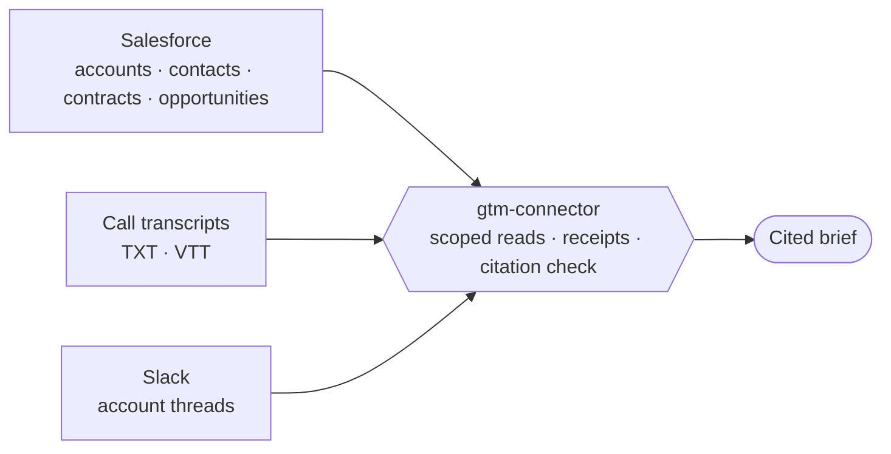

# gtm-connector

[](https://github.com/pwngh/gtm-connector/actions/workflows/test.yml?query=branch%3Amain)

Renewal briefs from Salesforce, call transcripts, and Slack. Every line cites the record it came
from, and every read needs a named scope and leaves an audit receipt. People use the CLI.
Assistants use the MCP tools.

- **Catches 284% more bad lines** than checking that every line cites evidence that was read:
  956 of 956, against 249.
- **Writes 20 briefs in 99% less time** than a local model drafting the same lines: 0.95 s, against
  103 s with `llama3.2`.

Twenty invented accounts on an Apple M1 Max laptop. [The results test](tests/test_results.py) adds
each bad line to a complete brief: a citation removed or changed, wording changed, a line repeated,
an uncited sentence, a cited invention. The times are `time gtm-connector evaluate`, alone and with
`--adapter ollama --model llama3.2:latest`.

## Sources in, a cited brief out



One account from the built-in invented data.

**In.** Five records from three sources. Three of them disagree:

| Source | Record | What it says |
| --- | --- | --- |
| CRM | `opp-003` | stage `closed_won`, USD 25,500.00, closed 2027-01-10 |
| Call | `note-003` | "Procurement has not approved this renewal. The budget remains unsigned." |
| Slack | `msg-003` | "Security review is delayed. Procurement approval is still pending." |

**Out.** Thirteen lines, every one cited. Four of them, wrapped to fit:

```text
- Renewal is in 31 days as of 2027-01-15. [crm/accounts/acc-003] [run/brief-…]

- CRM opportunity opp-003: stage "closed_won"; amount USD 25,500.00; close date 2027-01-10.
  [crm/opportunities/opp-003]

- Three-source conflict: CRM opportunity opp-003 reports stage "closed_won", call note note-003
  reports unapproved procurement, and Slack message msg-003 reports a delayed security review.
  [crm/opportunities/opp-003] [calls/call_notes/note-003] [slack/messages/msg-003]

- Proposed follow-up: Ask the account owner to confirm procurement and security review status.
  [crm/opportunities/opp-003] [calls/call_notes/note-003] [slack/messages/msg-003]
```

**What needs attention comes first.** Another account, `acc-002`:

```text
- Signal: renewal is in 24 days and opportunity opp-002 is still open at stage "evaluation".
  [crm/accounts/acc-002] [crm/opportunities/opp-002] [run/brief-…]

- Signal: CRM marks this account at risk: "Renewal budget is not approved.". [crm/accounts/acc-002]
```

[Signals](docs/briefs.md) come from structured fields and dates, never from reading source text. A
draft that omits one is rejected.

**As data.** `gtm-connector brief acc-003 --with-slack --json`, condensed:

```text
{
  "brief_id":   "brief-c9f33063…",
  "account_id": "acc-003",
  "as_of":      "2027-01-15",
  "status":     "accepted",
  "text":       "- Account: \"Cedarline Analytics\". [crm/accounts/acc-003]\n…",
  "proposed_follow_up": "- Proposed follow-up: Ask the account owner to confirm procurement and …",
  "model_usage": {"model": null, "input_tokens": 0, "output_tokens": 0},
  "evidence": {
    "records":  [ 5 source records, each with its record_ref ],
    "receipts": [ 4 audit receipts, one per read ]
  }
}
```

**One evidence record.** `[calls/call_notes/note-003]` in a line points at this, saved with the brief:

```json
{
  "id": "note-003",
  "account_id": "acc-003",
  "called_at": "2027-01-12T15:00:00Z",
  "body": "Procurement has not approved this renewal. The budget remains unsigned.",
  "record_ref": "calls/call_notes/note-003"
}
```

**The receipts.** One per read, committed before the read ran:

```text
get_account          ok   crm/accounts/acc-003  crm/contacts/con-003
list_opportunities   ok   crm/opportunities/opp-003
read_call_notes      ok   calls/call_notes/note-003
read_slack_messages  ok   slack/messages/msg-003
```

## Try it

Python 3.11 or later and pipx. Invented data, no model, no external service.

```sh
pipx run --spec 'git+https://github.com/pwngh/gtm-connector.git' gtm-connector demo
```

One rep prepares one renewal from CRM records, a call note, and a Slack message. `pipx install` with
the same source keeps the command on your PATH. From a checkout, `./scripts/demo.sh` installs the
pinned dependencies, runs the tests, and runs the demo. `gtm-connector --help` lists every command,
and `--json` gives [stable output](docs/cli.md).

## Use your own sources

Each source is selected explicitly. Nothing falls back to demo data.

| Source | Commands | Guide |
| --- | --- | --- |
| Salesforce, read-only | `salesforce check --sf-org ALIAS`, `serve --crm-backend salesforce --sf-org ALIAS` | [Salesforce](docs/salesforce.md) |
| Call transcripts (TXT, VTT) | `calls import meeting.vtt --account acc-007` | [Calls](docs/calls.md) |
| Slack sign-in | `slack connect`, `slack status`, `slack disconnect` | [Slack sign-in](docs/slack.md) |
| One Slack thread per account | `slack map`, `slack check` | [Slack threads](docs/slack.md) |
| Selected accounts for a client | `serve --selection selection.json` | [Selection](docs/selection.md) |

Salesforce uses an existing `sf` CLI login. Slack uses an existing public PKCE app. Tests use
invented provider responses. No live org has been verified.

## Daily commands

```sh
gtm-connector serve --state-dir var/v2
gtm-connector connect inspector --scope crm:read --state-dir var/v2
gtm-connector brief acc-007 --with-slack --state-dir var/brief   # its own folder while serve runs
gtm-connector audit --tool get_account --follow --state-dir var/v2
gtm-connector doctor --state-dir var/v2
```

`serve` prints one line per tool attempt with its decision and receipt ID. The Inspector CLI is the
tested client. Other assistant apps are untested. [Clients](docs/clients.md)

## What it guarantees

| Guarantee | Tests |
| --- | --- |
| One source's grant does not open another. A direct call without the scope returns HTTP 403. | [gateway](tests/test_gateway.py), [Slack](tests/test_slack_gateway.py) |
| A tool runs only after its audit receipt is committed. | [audit](tests/test_audit.py), [gateway](tests/test_gateway.py) |
| Retrying a write with the same key does not duplicate it. | [gateway](tests/test_gateway.py) |
| A note cannot direct the workflow. An instruction inside one appears quoted and creates nothing. | [briefing](tests/test_briefing.py) |
| A brief publishes only cited, supported lines. One bad line rejects the draft. | [citations](tests/test_citations.py) |
| With `serve --selection`, a client reads only the selected accounts, under its own grant. A source it lacks the scope for is disclosed as denied in the brief. | [selection](tests/test_selected_sources.py) |

The checker verifies wording and citations, not whether a source is true.

## Limits

- The drafter assembles fixed claims. It does not summarize free text yet.
- Authorization is a local owner emulator. The file owner can request every scope and edit the
  stores. Audit records are not tamper-proof. [Security review](SECURITY_REVIEW.md)
- macOS and Linux. No web interface, hosted model, or multi-user mode.

More: [commands and output](docs/cli.md), [tools, scopes, and protocol](docs/tools.md),
[briefs, evaluation, and local models](docs/briefs.md), [audit and usage](docs/audit.md),
[clients and Inspector](docs/clients.md), [working on the code](AGENTS.md).

MCP revision 2026-07-28, Python SDK 2.3.0. All checked-in companies, people, and records are
invented. MIT licensed.
