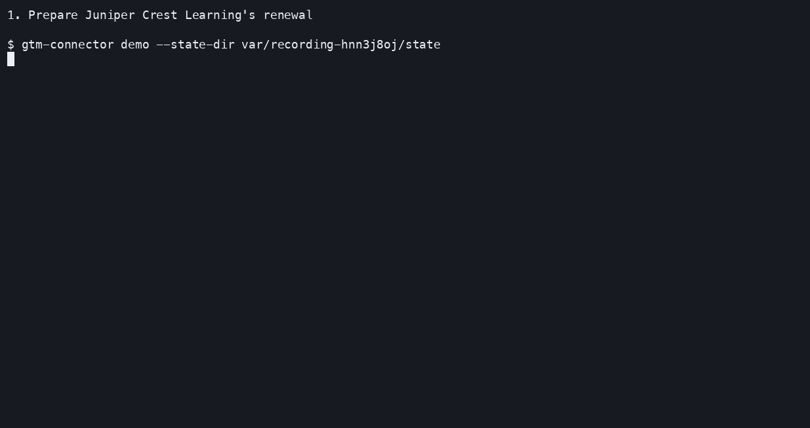
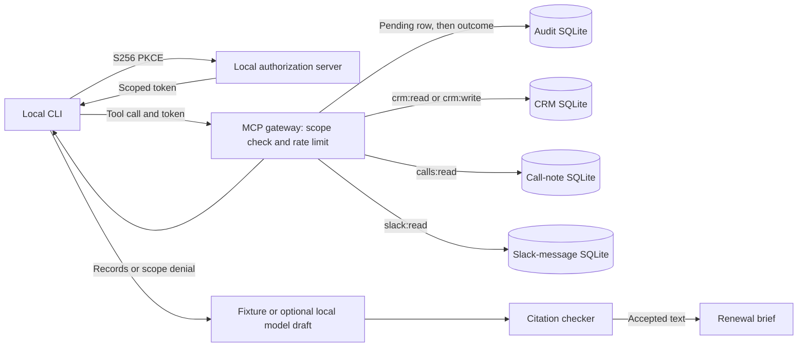
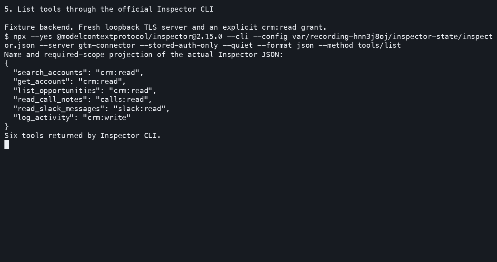

# GTM connector demo

[](https://github.com/pwngh/gtm-connector/actions/workflows/test.yml?query=branch%3Amain)

A renewal brief is an account summary a sales rep reads before a contract
renewal. Run `gtm-connector demo` to follow Morgan Reed preparing Juniper Crest Learning's
renewal from CRM records, a call note, and a Slack message. Every person, company,
and source in the demo is invented. The brief cites its records and receipts;
the follow-up remains a proposal.

The MCP (Model Context Protocol) server gives clients scoped access to these
sources and logs recognized tool calls. The brief checker requires supported
wording and matching citations.

Run the installed demo without cloning the repository (requires Python 3.11+
and pipx, with Git access to this repository):

```sh
pipx run --spec 'git+https://github.com/pwngh/gtm-connector.git' gtm-connector demo
```

Nothing is published to a package registry. The first install needs internet;
the default runtime needs no external service or key. [Installation](docs/install.md)
explains Git access and repeatable installs. `gtm-connector --help` lists commands
and examples. Use `--json` for scripts. [Output and exit codes](docs/cli.md)
describes the stable machine interface. `./scripts/demo.sh` still runs the
repository tests and fixture demo from a checkout.

[See it](#see-it) | [Run it](#run-it) | [Guarantees](#what-it-guarantees) |
[Limits](#limits-worth-reading) | [Reference](#reference)

[](docs/recording.md)

The quick demo, this recording, and the longer walkthrough follow the same
rep and account. The recording expands the same saved brief with selected
output from actual commands and shortened waits. No model runs.
[Transcript](docs/media/recording-session.txt),
[capture details](docs/media/recording-provenance.json), and
[rerun instructions](docs/recording.md).

## What it guarantees

The default drafter uses fixed claims; an optional local Ollama model can assemble
them too. Both pass through the same checker. It verifies wording and citations,
not whether a source is true.

- **Access to one source does not grant access to another.** CRM, call notes,
  and Slack messages require independent grants. Scope denials return HTTP 403.
  [Scope tests](tests/test_gateway.py#L182), [Slack scope tests](tests/test_slack_gateway.py)
- **A tool needs an audit receipt before it runs.** The gateway commits a `pending`
  row first and finalizes that row afterward. Failure to write the initial row
  stops execution. The guarantee excludes unparseable traffic with no tool-call
  marker and requests disconnected before execution.
  [Receipt test](tests/test_audit.py#L25),
  [failure test](tests/test_gateway.py#L373)
- **Retrying a write does not duplicate the activity.** Send the same idempotency
  key and payload to get the original activity. A changed payload returns
  `idempotency_conflict`. [Write test](tests/test_gateway.py#L293)
- **A note cannot direct the fixed workflow.** Its token is read-only, and its
  reads are planned in advance. The injected instruction appears as quoted
  data and creates no activity. This tests the workflow boundary without a model
  interpreting text.
  [Injection test](tests/test_briefing.py#L134)
- **The evidence must support the published claim.** An uncited, altered, or
  misattributed statement fails the check. The known conflict flag must cite both
  records. [Citation tests](tests/test_citations.py#L54),
  [conflict test](tests/test_citations.py#L150)

## What the mocks stand for

| Mock | What it represents |
| --- | --- |
| CRM store | The account, contact, deal, renewal, and activity records a sales team keeps. |
| Call-note store | Notes a call-recording service would attach to those accounts. This fixture stores text only. |
| Slack-message store | Internal account-channel messages about a renewal. This fixture has no connection to Slack. |

## See it

Morgan finds Juniper Crest Learning with a renewal in 14 days. A CRM-only grant
cannot read its call note. The demo then grants the three read scopes explicitly
and prepares one brief from CRM, calls, and Slack. An instruction embedded in a
note stays quoted evidence. No activity is created and nothing is sent.

The fixed date `2027-01-15` keeps renewal calculations repeatable; it is not the
execution date. The longer [walkthrough](DEMO.md) expands this same brief with
its receipts, an evidence check, and a rejected uncited sentence.

Record claims cite `crm/...`, `calls/call_notes/...`, or `slack/messages/...`.
An empty query or denied grant cites its `audit/...` receipt. Renewal-day
calculations also cite the saved `run/...` date. The checker validates supported
wording against this evidence; it does not establish whether a source is true.

The separate `gtm-connector verify` command runs the guarantee checks, including
rate limits and idempotent writes to the local demo store. It is a verification
tool, not another version of the rep's story.

### Fixture evaluation

The evaluation compares briefs for 20 fixed accounts with checked-in expected
claims. Each displayed line counts once, including compound contact and
opportunity statements.

The current fixture run and exact command are saved in
[evaluation/RESULTS.json](evaluation/RESULTS.json). The adapter is `fixture`;
the model is `null` because no model runs.

| Measure | Result |
| --- | --- |
| Accounts with accepted briefs | 20 / 20 |
| Expected claims found | 182 / 182 |
| Claims cited correctly | 182 / 182 |
| Invented claims | 0 of 182 emitted claims |

The 182 of 182 counts measure fixed claim lines found and cited correctly against
fixed answers. They do not measure model quality; the drafter and checker share
supported wording. The run recorded 60 successful audit receipts, zero activities,
and zero model tokens.
[Results](evaluation/RESULTS.json)
[Expected claims](evaluation/expected.json)
[Scoring rules](docs/evaluation.md)

### Local model measurement

This historical run used the earlier synthetic-label fixture book, before the
current invented companies and notes. It has not been rerun on the current book.
The optional drafter ran `llama3.2:latest` through Ollama 0.30.0 on 2026-11-17,
from `20:51:09` to `20:53:23` UTC. The response identified the model as
`llama3.2:latest:local`. The request used the local-only selector.

```sh
.venv/bin/python -m gtm_connector evaluate --adapter ollama --model llama3.2:latest
```

| Measure | Fixture baseline | Local model |
| --- | --- | --- |
| Accepted briefs | 20 / 20 | 20 / 20 |
| Published claims found and cited | 182 / 182 | 182 / 182 |
| Rejected briefs | 0 | 0 |
| Unsupported published claims | 0 | 0 |
| Reported input / output tokens | 0 / 0 | 3384 / 5500 |

The model emitted 182 candidate lines. All 20 candidates were scored, with zero
lines rejected. Local inference passed through the checker. This run provides no
evidence that the model hallucinated or that the checker caught a hallucination.

The model's task is fixed-claim assembly. Separate adverse tests supply uncited,
invented, miscited, duplicate, and action-shaped candidates. Each fails without
publishing any part of the brief.
[Model results and exact command](evaluation/RESULTS_OLLAMA.json)
[Rejection tests](tests/test_model_workflow.py)
[Local model limits](docs/ollama.md)

## Request path



The local authorization server issues a token with named permissions, called
scopes. CRM, calls, and Slack need separate grants. The client sends its token
with the tool name and arguments.

The gateway writes a pending audit receipt before checking the token, scope, and
rate limit. Rejected calls stop there. Allowed tools return records marked as
untrusted data, each with a `record_ref`. Before returning the result, the gateway
finalizes the receipt: a record of the attempt and its outcome.

The briefing workflow requests read scopes only. The default brief has three
receipts. `--with-slack` adds a fourth read and a checked follow-up proposal.

Returned records and receipts form a saved evidence snapshot. The drafter gets a
copy, without a token or tool interface. Each candidate line must match supported
wording and exact references.

The brief distinguishes an empty call-note or Slack result from a denied grant
and cites the receipt. Other read failures stop it. A failed citation check
withholds the whole draft, including lines that passed. Saved evidence lets the
operator check another candidate against the same records later.

## Run it

The demo runs from a clean checkout:

```sh
./scripts/demo.sh
```

A local run needs macOS or Linux and Python 3.11+ with SQLite and venv support. The
first dependency install needs internet. Runtime needs no external service,
account, model, or API key. The script runs the tests and two local HTTPS services.

The 30 invented accounts span several industries and use reserved `.example`
addresses. The book includes conflicting signals, a dated October note, an
unrecorded contact role, and missing sources. The quick demo follows just one
account. It creates six receipts and one saved brief, changes no activity rows,
and stops both services. State stays in the gitignored `var/renewal-demo`
directory. Existing `var/v2` data is preserved.

The longer walkthrough expands the same account's evidence and receipts:

```sh
./scripts/five-minute-demo.sh
```

It prints its private output directory. Follow [the guide](DEMO.md). To run the
separate guarantee checks in their own state:

```sh
gtm-connector verify --with-slack --state-dir var/verification
```

### Use the daily commands

```sh
gtm-connector serve --state-dir var/v2
gtm-connector doctor --state-dir var/v2
gtm-connector connect inspector --scope crm:read --state-dir var/v2
gtm-connector audit --tool get_account --follow --state-dir var/v2
gtm-connector usage --state-dir var/v2
```

The server prints its address and setup instructions, then one line for each
recognized tool attempt. The line includes its decision and receipt ID. Audit
and usage support filters and follow mode. Doctor reports local setup failures
with fixes. Evaluation reports progress on stderr. `completion` prints setup
for bash, zsh, or fish. [Daily command reference](docs/cli.md)

Inspector CLI is tested with an explicit local grant. `connect` also prints
configuration for Claude Code and Cursor, marked untested. Claude Desktop
cannot reach this loopback HTTP server through its remote connector; its local
stdio path is not implemented. Normal assistant login cannot complete against
the local owner emulator. [Client setup and exact limits](docs/clients.md)

### Run in Codespaces

[](https://codespaces.new/pwngh/gtm-connector)

You can create a codespace through the link above, then run `./scripts/demo.sh`
in its browser terminal. The
[development container](.devcontainer/devcontainer.json)
supplies Python 3.11; the demo installs its dependencies. Setup needs internet.
Client and services run inside the container with automatic port forwarding disabled.

Codespaces uses your account's compute and storage allowance.
[GitHub explains the billing rules](https://docs.github.com/en/billing/concepts/product-billing/github-codespaces).
Stop the codespace when finished. Delete it when you no longer need its files;
stopped codespaces still use storage.

The container passed the five-minute demo locally on Linux arm64 with Python
3.11.18. Codespaces creation and the browser editor have not been tested.

## Optional features

### Use an external MCP client



Inspector tests MCP servers. This frame shows tool names and scopes from a real CLI response.
[Full tools/list JSON](docs/media/inspector-tools.json).
It uses a supplied local grant, not an interactive login or the Inspector UI.

The optional [Inspector walkthrough](docs/inspector.md) starts the server and
creates a private config with explicitly granted scopes. After that setup:

```sh
NODE_EXTRA_CA_CERTS="$PWD/var/inspector/tls.pem" npx --yes @modelcontextprotocol/inspector@2.15.0 --cli --config var/inspector/inspector.json --server gtm-connector --stored-auth-only --quiet --format json --method tools/list
```

Inspector 2.15.0 discovers MCP 2026-07-28, lists all six tools, and reads the three
sources through the gateway. The [integration check](scripts/check-inspector.py)
proves separation for every pair of source grants and one receipt per tool
attempt. It also checks HTTP 429 and HTTP 401. Only this optional client check
needs Node and npm downloads.

### Use a local model

These commands require Ollama to be running with a model already installed:

```sh
.venv/bin/python -m gtm_connector brief acc-003 --adapter ollama --model llama3.2:latest --json
.venv/bin/python -m gtm_connector evaluate --adapter ollama --model llama3.2:latest
```

The model gets supported claims derived from authorized evidence. It receives
no credentials or tool access, and any invalid line rejects the entire draft.
The adapter rejects cloud aliases; it never downloads a model or calls a hosted
service.
[Setup, measurements, and limits](docs/ollama.md)

### Include account-channel context

```sh
.venv/bin/python -m gtm_connector brief acc-003 --with-slack --json
.venv/bin/python -m gtm_connector evaluate --with-slack
```

This adds a `slack:read` grant and a fourth audited read. The output includes
`proposed_follow_up`, a suggested next step copied from the checked brief. The
`acc-003` fixture flags the CRM, call-note, and Slack disagreement with all three
references. The proposal sends nothing.
[Slack fixtures, denial cases, and limits](docs/slack.md)

The current extended evaluation uses the fixture adapter and no model.
It found and correctly cited 223 of 223 claims, with zero
invented claims, 80 audit receipts, and zero activities.
[Exact command and results](evaluation/RESULTS_SLACK.json)

### Read an existing Salesforce org

Use an existing Salesforce CLI login to check and start the read-only backend:

```sh
gtm-connector salesforce check --sf-org gtm-de
gtm-connector serve --crm-backend salesforce --sf-org gtm-de --state-dir var/salesforce
```

The process captures the instance address and token from `sf`; no exported token
is needed. The existing environment-variable path remains available. Standard
Contract records supply the renewal-planning date. Draft and InApproval records
must be labeled as planning candidates, and an account without an eligible
EndDate refuses a brief. The adapter is GET-only and omits `log_activity`.
Developer Edition remains the default. An existing sandbox or production
connection requires an explicit `--sf-environment sandbox` or
`--sf-environment production`. Startup checks that expectation and pins the
connection to its private state folder. `accounts` and `account` also accept
the Salesforce flags and read through the audited gateway. The standard-object
capability and state-switch tests use invented responses; paid orgs have not
been exercised. [Connection choices and account reads](docs/salesforce.md#choose-the-expected-environment)

Call notes default to local fixtures and can instead use an explicitly imported
transcript. Slack remains a local fixture. The optional invented demo kit binds
them to imported accounts through standard AccountNumber values; it does not
connect a call-recording provider or Slack.

Tests use invented HTTP responses and a fake CLI. No live org has been verified.
The setup check emits pass/fail steps, counts, timings, and connector GET attempts
without org records or credentials, so its JSON report can be shared. Ordinary
briefs and audit files remain private.
[Setup, field mapping, and limits](docs/salesforce.md)

The [Salesforce demo kit](docs/salesforce-demo.md) contains three invented
accounts with contacts, opportunities, and Draft contracts, twelve records in
one import plan. An owner-run helper binds the import receipt, creates a cited
brief with invented local notes and Slack messages, records privately, and
removes the exact imported records after checking their fields and relationships.
The connector stays GET-only. Keep import receipts, bindings, recordings, and
source-bearing state private under `var/`; cleanup has the visibility and
concurrency limits described in the guide.

### Use an existing call transcript

Import a TXT or VTT export, associate it with an account, and quote an exact
excerpt in the brief:

```sh
gtm-connector calls import meeting.vtt --account acc-007
gtm-connector brief acc-007 --calls-backend imported --state-dir var/imported-calls
```

This example uses the invented CRM account and your selected file. Salesforce
imports use an explicit AccountNumber or native account ID with the same
connection flags. The import resolves that association through an audited CRM
read. Later call reads require their separate scope and quote only the selected
units. Unknown meeting time stays unknown; originals and older revisions remain
private. No call provider, recording, transcription, or hosted model is started.
[Import commands, export locations, and evidence limits](docs/calls.md)

## Limits worth reading

The default drafter is a deterministic fixture, so its score measures that
workflow rather than model quality. Optional Ollama drafting also assembles
fixed claims. It does not support unrestricted summaries.

The checker accepts fixed wording and permits some omissions. Missing notes
and recognized conflicts must stay visible. Slack mode also requires its
empty or denied outcome and a cited follow-up proposal. [Brief limits](docs/briefs.md)

Authorization uses a local owner emulator. The file owner can request every
scope and alter the stores; audit records and snapshots are not tamper-proof.
Retention is manual. Snapshot replacement is atomic, but it does not guarantee
power-loss durability. [Security review](SECURITY_REVIEW.md)

If audit finalization returns HTTP 503, a write may already have committed.
Retry the same key and reconcile any pending row. The audit CLI reads existing
receipts without initializing tables or changing file permissions.
[Audit details](docs/audit.md)

Read-only usage reporting groups attempts by credential, tool, and UTC day.
Rejected credentials and `anonymous` count too. Unknown model usage
stays `null`, and totals cover saved snapshots only. [Usage details](docs/usage.md)

The implemented MCP and authorization revision is **2026-07-28**, read
**2026-11-17**. The Python SDK version is **2.3.0**. The included client and
Inspector CLI 2.15.0 are tested. Other
assistant applications and interactive external login are unverified.
[Protocol details](docs/protocol.md)

The default runtime stays offline. The explicitly selected Salesforce reader
and local transcript importer are described above.

Custom Python adapters are not sandboxed or selectable through the CLI. No
hosted model adapter, call-recording provider API, web interface,
or multi-tenant behavior is included.

## Reference

[Development checks](docs/development.md) explains linting, type checks, and dependency locks.
[Performance measurements](docs/performance.md) records startup and audited call timings with rerun commands.
[Tools and fixture data](docs/tools.md) documents each tool and its required scope.
[Imported transcripts](docs/calls.md) explains explicit account associations and cited excerpts.
[Design decisions](DECISIONS.md) explains the choices;
[Rules the coding agents worked under](AGENTS.md) records the constraints.

This is a portfolio project for Preston Neal. The checked-in companies, people, and records are invented. Optional Salesforce reads return records from the operator's org.

The project is MIT licensed.
