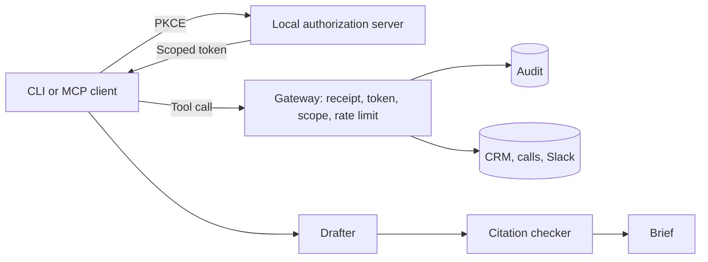

# gtm-connector

[](https://github.com/pwngh/gtm-connector/actions/workflows/test.yml?query=branch%3Amain)

A local connector that builds cited renewal briefs from CRM records, call transcripts, and Slack
threads. People use its CLI. Assistants use its MCP tools. Every read needs a named scope and leaves
an audit receipt, and every line of a brief cites the record it came from.

## Try it

Python 3.11 or later and pipx. Invented data, no model, no external service.

```sh
pipx run --spec 'git+https://github.com/pwngh/gtm-connector.git' gtm-connector demo
```

One rep prepares one renewal from CRM records, a call note, and a Slack message. `pipx install` with
the same source keeps the command on your PATH. From a checkout, `./scripts/demo.sh` installs the
pinned dependencies, runs the tests, and runs the demo.
`gtm-connector --help` lists every command, and `--json` gives [stable output](docs/cli.md).

## What it guarantees

| Guarantee | Tests |
| --- | --- |
| One source's grant does not open another. A direct call without the scope returns HTTP 403. | [gateway](tests/test_gateway.py), [Slack](tests/test_slack_gateway.py) |
| A tool runs only after its audit receipt is committed. | [audit](tests/test_audit.py), [gateway](tests/test_gateway.py) |
| Retrying a write with the same key does not duplicate it. | [gateway](tests/test_gateway.py) |
| A note cannot direct the workflow. An instruction inside one appears quoted and creates nothing. | [briefing](tests/test_briefing.py) |
| A brief publishes only cited, supported lines. One bad line rejects the draft. | [citations](tests/test_citations.py) |
| With `serve --selection`, a client reads only the selected accounts, under its own grant. A source it lacks the scope for is disclosed as denied in the brief. | [selection](tests/test_selected_sources.py) |

The checker verifies wording and citations, not whether a source is true.

## Measured results

Twenty invented accounts, each briefed from CRM, calls, and Slack. A test asserts every count
below except the model row and the timings, which the command beside them reproduces.

| What | Result | Check |
| --- | --- | --- |
| Input | 98 source records through 80 audited reads | [results test](tests/test_results.py) |
| Output | 20 briefs, 223 lines, 2,482 words, 248 citations | same |
| Lines that cite their source | 223 of 223 | same |
| Expected claims found and cited correctly | 182 of 182, and 223 of 223 with Slack | `gtm-connector evaluate`, `--with-slack` |
| Invented claims published | 0 | same |
| Corrupted drafts rejected: a citation removed or changed, wording changed, a line repeated, a sentence invented | 932 of 932 | [results test](tests/test_results.py) |
| Tool calls with a finished receipt | 80 of 80 | same |
| Drafts by a local model, `llama3.2`, accepted by the checker | 20 of 20, with 182 of 182 claims and 0 rejected lines, from 8,758 tokens in and 5,518 out | `gtm-connector evaluate --adapter ollama --model llama3.2:latest` |
| Time for 20 briefs | About 1 s without a model, 97 s with `llama3.2` | `time gtm-connector evaluate` |
| Time per audited read, receipt included | 1.6 ms median, 2.2 ms at the 95th percentile | `elapsed_ms` in `gtm-connector audit --json` |
| Demo, from start to a finished brief | 0.9 s | `time gtm-connector demo` |

Timings are from an Apple M1 Max laptop. The fixed drafter and the model both assemble claims the
connector derived, so these numbers measure the pipeline and the checker, not free-text summarizing.

## Use your own sources

Each source is selected explicitly. Nothing falls back to demo data.

| Source | Commands | Guide |
| --- | --- | --- |
| Salesforce, read-only | `salesforce check --sf-org ALIAS`, `serve --crm-backend salesforce --sf-org ALIAS` | [Salesforce](docs/salesforce.md) |
| Call transcripts (TXT, VTT) | `calls import meeting.vtt --account acc-007` | [Calls](docs/calls.md) |
| Slack sign-in | `slack connect`, `slack status`, `slack disconnect` | [Slack sign-in](docs/slack.md) |
| One Slack thread per account | `slack map`, `slack check` | [Slack threads](docs/slack.md) |
| Selected accounts for a client | `serve --selection selection.json` | [Selection](docs/selection.md) |

Salesforce uses an existing `sf` CLI login. Slack uses an existing public PKCE app. Tests use
invented provider responses. No live org has been verified.

## Daily commands

```sh
gtm-connector serve --state-dir var/v2
gtm-connector connect inspector --scope crm:read --state-dir var/v2
gtm-connector brief acc-007 --with-slack --state-dir var/brief   # its own folder while serve runs
gtm-connector audit --tool get_account --follow --state-dir var/v2
gtm-connector doctor --state-dir var/v2
```

`serve` prints one line per tool attempt with its decision and receipt ID. The Inspector CLI is the
tested client. Other assistant apps are untested. [Clients](docs/clients.md)

## How a request flows



## Limits

- The drafter assembles fixed claims. It does not summarize free text yet.
- Authorization is a local owner emulator. The file owner can request every scope and edit the
  stores. Audit records are not tamper-proof. [Security review](SECURITY_REVIEW.md)
- macOS and Linux. No web interface, hosted model, or multi-user mode.

More: [commands and output](docs/cli.md), [tools, scopes, and protocol](docs/tools.md),
[briefs, evaluation, and local models](docs/briefs.md), [audit and usage](docs/audit.md),
[clients and Inspector](docs/clients.md), [working on the code](AGENTS.md).

MCP revision 2026-07-28, Python SDK 2.3.0. All checked-in companies, people, and records are
invented. MIT licensed.
