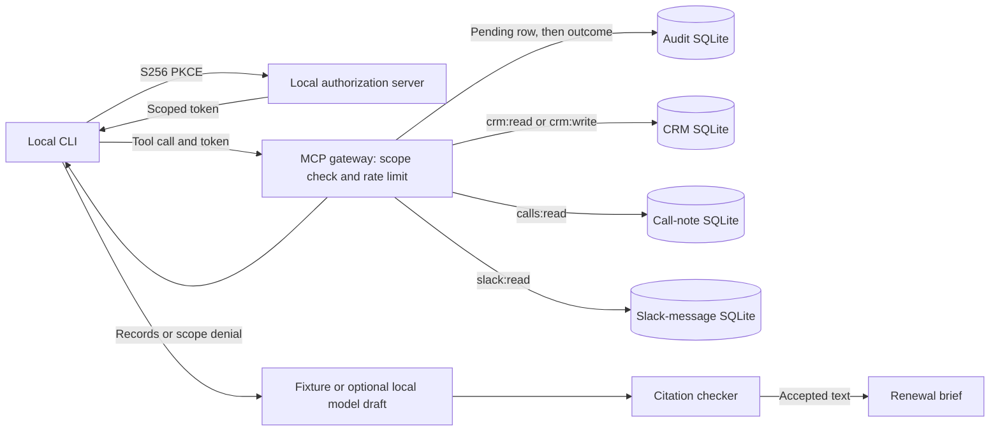

# GTM connector demo

A renewal brief is an account summary a sales rep reads before a contract
renewal. This project drafts one from a mock CRM (customer records) and call
notes, with optional Slack account messages. Each statement cites its source or
audit record.

The MCP (Model Context Protocol) server gives clients scoped access to these
sources and logs recognized tool calls. The brief checker requires supported
wording and matching citations.

The command `./scripts/demo.sh` installs dependencies, then runs the tests and
demo on invented data from a clean checkout. The first install needs internet; the
default runtime needs no external service or key.

[](docs/recording.md)

This scripted recording runs real commands on fresh fixtures, with selected
output and shortened waits. No model runs.
[Transcript](docs/media/recording-session.txt),
[capture details](docs/media/recording-provenance.json), and
[rerun instructions](docs/recording.md).

## What it guarantees

The default drafter uses fixed claims; an optional local Ollama model can assemble
them too. Both pass through the same checker. It verifies wording and citations,
not whether a source is true.

- **Access to one source does not grant access to another.** CRM, call notes,
  and Slack messages require independent grants. Scope denials return HTTP 403.
  [Scope tests](tests/test_gateway.py#L182), [Slack scope tests](tests/test_slack_gateway.py)
- **A tool needs an audit receipt before it runs.** The gateway commits a `pending`
  row first and finalizes that row afterward. Failure to write the initial row
  stops execution. The guarantee excludes unparseable traffic with no tool-call
  marker and requests disconnected before execution.
  [Receipt test](tests/test_audit.py#L25),
  [failure test](tests/test_gateway.py#L373)
- **Retrying a write does not duplicate the activity.** Send the same idempotency
  key and payload to get the original activity. A changed payload returns
  `idempotency_conflict`. [Write test](tests/test_gateway.py#L293)
- **A note cannot direct the fixed workflow.** Its token is read-only, and its
  three reads are planned in advance. The injected instruction appears as quoted
  data and creates no activity. This tests the workflow boundary without a model
  interpreting text.
  [Injection test](tests/test_briefing.py#L134)
- **The evidence must support the published claim.** An uncited, altered, or
  misattributed statement fails the check. The known conflict flag must cite both
  records. [Citation tests](tests/test_citations.py#L54),
  [conflict test](tests/test_citations.py#L150)

## What the mocks stand for

| Mock | What it represents |
| --- | --- |
| CRM store | The account, contact, deal, renewal, and activity records a sales team keeps. |
| Call-note store | Notes a call-recording service would attach to those accounts. This fixture stores text only. |
| Slack-message store | Internal account-channel messages about a renewal. This fixture has no connection to Slack. |

## See it

The captured brief for `acc-003` shows a deal marked won while its call note says
approval is missing. The fixed demo date `2027-01-15` keeps renewal calculations
repeatable; it is not the execution date.

```text
- CRM opportunity opp-003: stage "closed_won"; amount USD 25,500.00; close date 2027-01-10. [crm/opportunities/opp-003]
- Untrusted call note note-003 at "2027-01-12T15:00:00Z" says "Procurement has not approved this renewal. The budget remains unsigned.". [calls/call_notes/note-003]
- Source conflict: CRM opportunity opp-003 reports stage "closed_won", while call note note-003 reports unapproved procurement. [crm/opportunities/opp-003] [calls/call_notes/note-003]
```

Record claims cite `crm/...` or `calls/call_notes/...`. An empty query result or
denied call-note grant cites its `audit/...` receipt instead. Renewal-day
calculations also cite the saved `run/...` date.

The checker accepted the captured brief. Appending `The renewal was approved.`
made it exit with code `2`, print nothing to stdout, and return:

```text
error: Brief contains an uncited, unsupported, or misattributed statement.
```

<details>
<summary>Inspect a real call-note receipt</summary>

The complete receipt below belongs to the captured brief. Its `token_id` is a
SHA-256 fingerprint, not a reusable bearer token. IDs and timestamps vary per run.

```json
{
  "audit_id": "9684fab8-5e7e-41a8-86e5-dec22e774624",
  "started_at": "2026-11-17T19:56:52.314305Z",
  "token_id": "905a643f389384f2267fb155184c25fce82d1b69ee91b8b140795b4c0d28454b",
  "tool": "read_call_notes",
  "arguments": {
    "account_id": "acc-003"
  },
  "request_id": 3,
  "brief_id": "brief-008c10f70b2c4d05ad78368d22a2568f",
  "status": "ok",
  "http_status": 200,
  "row_count": 1,
  "rows": [
    "calls/call_notes/note-003"
  ],
  "elapsed_ms": 3.656832966953516,
  "error": null
}
```

</details>

### Fixture evaluation

The evaluation compares briefs for 20 fixed accounts with checked-in expected
claims. Each displayed line counts once, including compound contact and
opportunity statements.

The recorded run used `.venv/bin/python -m gtm_connector evaluate` on 2026-11-17.
The adapter is `fixture`; the model is `null` because no model runs.

| Measure | Result |
| --- | --- |
| Accounts with accepted briefs | 20 / 20 |
| Expected claims found | 182 / 182 |
| Claims cited correctly | 182 / 182 |
| Invented claims | 0 of 182 emitted claims |

The 182 of 182 counts measure fixed claim lines found and cited correctly against
fixed answers. They do not measure model quality; the drafter and checker share
supported wording. The run recorded 60 successful audit receipts, zero activities,
and zero model tokens.
[Results](evaluation/RESULTS.json)
[Expected claims](evaluation/expected.json)
[Scoring rules](docs/evaluation.md)

### Local model measurement

The optional drafter ran `llama3.2:latest` through Ollama 0.30.0 on 2026-11-17,
from `20:51:09` to `20:53:23` UTC. The response identified the model as
`llama3.2:latest:local`. The request used the local-only selector.

```sh
.venv/bin/python -m gtm_connector evaluate --adapter ollama --model llama3.2:latest
```

| Measure | Fixture baseline | Local model |
| --- | --- | --- |
| Accepted briefs | 20 / 20 | 20 / 20 |
| Published claims found and cited | 182 / 182 | 182 / 182 |
| Rejected briefs | 0 | 0 |
| Unsupported published claims | 0 | 0 |
| Reported input / output tokens | 0 / 0 | 3384 / 5500 |

The model emitted 182 candidate lines. All 20 candidates were scored, with zero
lines rejected. Local inference passed through the checker. This run provides no
evidence that the model hallucinated or that the checker caught a hallucination.

The model's task is fixed-claim assembly. Separate adverse tests supply uncited,
invented, miscited, duplicate, and action-shaped candidates. Each fails without
publishing any part of the brief.
[Model results and exact command](evaluation/RESULTS_OLLAMA.json)
[Rejection tests](tests/test_model_workflow.py)
[Local model limits](docs/ollama.md)

## Request path



The local authorization server issues a token with named permissions, called
scopes. CRM, calls, and Slack need separate grants. The client sends its token
with the tool name and arguments.

The gateway writes a pending audit receipt before checking the token, scope, and
rate limit. Rejected calls stop there. Allowed tools return records marked as
untrusted data, each with a `record_ref`. Before returning the result, the gateway
finalizes the receipt: a record of the attempt and its outcome.

The briefing workflow requests read scopes only. The default brief has three
receipts. `--with-slack` adds a fourth read and a checked follow-up draft.

Returned records and receipts form a saved evidence snapshot. The drafter gets a
copy, without a token or tool interface. Each candidate line must match supported
wording and exact references.

The brief distinguishes an empty call-note or Slack result from a denied grant
and cites the receipt. Other read failures stop it. A failed citation check
withholds the whole draft, including lines that passed. Saved evidence lets the
operator check another candidate against the same records later.

## Run it

[](https://codespaces.new/pwngh/gtm-connector)

You can create a codespace through the link above, then run the command below
in its browser terminal. The
[development container](.devcontainer/devcontainer.json)
supplies Python 3.11; the demo installs its dependencies. Setup needs internet.
Client and services run inside the container with automatic port forwarding disabled.

Codespaces uses your account's compute and storage allowance.
[GitHub explains the billing rules](https://docs.github.com/en/billing/concepts/product-billing/github-codespaces).
Stop the codespace when finished. Delete it when you no longer need its files;
stopped codespaces still use storage.

The container passed the five-minute demo locally on Linux arm64 with Python
3.11.18. Codespaces creation and the browser editor have not been tested.

The demo runs from a clean checkout:

```sh
./scripts/demo.sh
```

A local run needs macOS or Linux and Python 3.11+ with SQLite and venv support. The
first dependency install needs internet. Runtime needs no external service,
account, model, or API key. The script runs the tests and two local HTTPS services.

The 30 invented accounts use reserved `.example` addresses. You will see HTTP 403
for a denied read and HTTP 429 at the rate limit. Retried writes create no
duplicates; the injected note causes zero writes. The run creates 14 connector
receipts and nine briefing receipts, then stops both services. State stays in
the gitignored `var/v2` directory.

The full walkthrough adds evaluation, usage, and a live citation rejection:

```sh
./scripts/five-minute-demo.sh
```

It prints its private output directory. Follow [the five-minute guide](DEMO.md).

### Use an external MCP client


Inspector tests MCP servers. This frame shows tool names and scopes from a real CLI response.
[Full tools/list JSON](docs/media/inspector-tools.json).
It uses a supplied local grant, not an interactive login or the Inspector UI.

The optional [Inspector walkthrough](docs/inspector.md) starts the server and
creates a private config with explicitly granted scopes. After that setup:

```sh
NODE_EXTRA_CA_CERTS="$PWD/var/inspector/tls.pem" npx --yes @modelcontextprotocol/inspector@2.15.0 --cli --config var/inspector/inspector.json --server gtm-connector --stored-auth-only --quiet --format json --method tools/list
```

Inspector 2.15.0 discovers MCP 2026-07-28, lists all six tools, and reads the three
sources through the gateway. The [integration check](scripts/check-inspector.py)
proves separation for every pair of source grants and one receipt per tool
attempt. It also checks HTTP 429 and HTTP 401. Only this optional client check
needs Node and npm downloads.

### Use a local model

These commands require Ollama to be running with a model already installed:

```sh
.venv/bin/python -m gtm_connector brief acc-003 --adapter ollama --model llama3.2:latest --json
.venv/bin/python -m gtm_connector evaluate --adapter ollama --model llama3.2:latest
```

The model gets supported claims derived from authorized evidence. It receives
no credentials or tool access, and any invalid line rejects the entire draft.
The adapter rejects cloud aliases; it never downloads a model or calls a hosted
service.
[Setup, measurements, and limits](docs/ollama.md)

### Include account-channel context

```sh
.venv/bin/python -m gtm_connector brief acc-003 --with-slack --json
.venv/bin/python -m gtm_connector evaluate --with-slack
```

This adds a `slack:read` grant and a fourth audited read. The output includes
`proposed_follow_up`, a suggested next step copied from the checked brief. The
`acc-003` fixture flags the CRM, call-note, and Slack disagreement with all three
references. The proposal sends nothing.
[Slack fixtures, denial cases, and limits](docs/slack.md)

The extended evaluation ran on 2026-11-17 at `21:11:19` UTC with the fixture adapter
and no model. It found and correctly cited 223 of 223 claims, with zero
invented claims, 80 audit receipts, and zero activities.
[Exact command and results](evaluation/RESULTS_SLACK.json)

### Read a Salesforce Developer Edition org

The server requires `SALESFORCE_INSTANCE_URL` and `SALESFORCE_ACCESS_TOKEN` to be
set privately before this command runs:

```sh
.venv/bin/python -m gtm_connector serve --crm-backend salesforce --state-dir var/salesforce
```

The three CRM read tools now issue Salesforce REST queries, after checking that
the org is Developer Edition. In this mode, `log_activity` is unavailable.
Call notes and Slack remain separate mocks. Because renewal fields are not
mapped, the adapter refuses brief generation. Tests use invented HTTP responses;
no live org has been verified. [Setup, field mapping, and limits](docs/salesforce.md)

## Limits worth reading

The default drafter is a deterministic fixture, so its score measures that
workflow rather than model quality. Optional Ollama drafting also assembles
fixed claims. It does not support unrestricted summaries.

The checker accepts fixed wording and permits some omissions. Missing notes
and recognized conflicts must stay visible. Slack mode also requires its
empty or denied outcome and a cited follow-up proposal. [Brief limits](docs/briefs.md)

Authorization uses a local owner emulator. The file owner can request every
scope and alter the stores; audit records and snapshots are not tamper-proof.
Retention is manual. Snapshot replacement is atomic, but it does not guarantee
power-loss durability. [Security review](SECURITY_REVIEW.md)

If audit finalization returns HTTP 503, a write may already have committed.
Retry the same key and reconcile any pending row. The audit CLI reads existing
receipts without initializing tables or changing file permissions.
[Audit details](docs/audit.md)

Read-only usage reporting groups attempts by credential, tool, and UTC day.
Rejected credentials and `anonymous` count too. Unknown model usage
stays `null`, and totals cover saved snapshots only. [Usage details](docs/usage.md)

The implemented MCP and authorization revision is **2026-07-28**, read
**2026-11-17**. The Python SDK version is **2.3.0**. The included client and
Inspector CLI 2.15.0 are tested. Other
assistant applications and interactive external login are unverified.
[Protocol details](docs/protocol.md)

The following exclusions describe the default fixture runtime. The explicitly
selected Salesforce read adapter is described above.

Custom Python adapters are not sandboxed or selectable through the CLI. No
hosted model adapter, real CRM or call-recording integration, web interface,
or multi-tenant behavior is included.

## Reference

[Tools and fixture data](docs/tools.md) documents each tool and its required scope.
[Design decisions](DECISIONS.md) explains the choices;
[Rules the coding agents worked under](AGENTS.md) records the constraints.

This is a portfolio project for Preston Neal. The checked-in fixture records use synthetic
labels. Optional Salesforce reads return records from the operator's org.

The project is MIT licensed.
