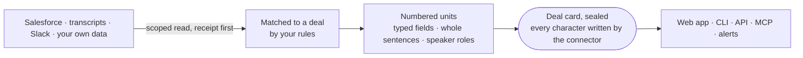

# gtm-connector

[](https://github.com/pwngh/gtm-connector/actions/workflows/test.yml?query=branch%3Amain)

**Contrast what a CRM reports about a renewal with what participants actually said, side by side, with a verifiable source behind every line.**

**It allows revenue teams to audit renewal health in 30 seconds, catch unrecorded deal risks before they stall a close, and trace every claim back to its exact source without trusting an AI summary.**

`gtm-connector` compiles a **Deal card** for an upcoming renewal from Salesforce records, call
transcripts, and Slack messages. Every figure, date, name, and quotation resolves to the stored
record it came from and to the write-once receipt of the read that returned it. Each sentence is
attributed to an identity-resolved speaker, marked `unknown` when two candidates match or none does,
and every card declares what it did not read. **The connector writes every character
deterministically. No language model writes the card.**

> [!NOTE]
> **In active development.** Parts of this page and the linked guides describe subsystems still
> being built. The [roadmap](docs/ROADMAP.md) tracks which.

| Architectural property | Specification |
| :--- | :--- |
| **Zero-model compilation** | **0** language-model calls assemble a Deal card |
| **Line-level provenance** | Every figure and quotation is numbered to its source record and the receipt of the read that returned it |
| **Tamper-evident sealing** | Each published card's **SHA-256** digest is recorded in its seal receipt, and a card with a changed byte is refused |
| **Adversarial cases** | **10 of 10** invented hard cases rebuilt byte for byte |
| **Access interfaces** | Web app, CLI, HTTP API, and **MCP** (`2026-07-28`) |

---

## Demonstration

The demonstration models a renewal for an invented law firm, **Thornfield Wren LLP**. Its CRM risk
reads `healthy`. Three days earlier, on a call, the customer's deputy general counsel said their
general counsel will not sign until a rider is approved. The Deal card shows both facts side by
side and cites where each came from.

1. **Start the database and the server, and make the demo cards:**

   ```sh
   make up      # PostgreSQL and the server, in Docker Compose
   make demo    # a sealed Deal card for each account of the invented demo book
   ```

2. **Open the cards:** go to `https://127.0.0.1:8443/` and sign in with the demo sign-in. It runs
   locally on invented data, with no external service and no model.

The card for Thornfield Wren LLP:

```text
DEAL CARD: "Thornfield Wren LLP" (acc-003) as of 2027-01-15
Sources read 2027-01-15T14:00:02Z.

ATTENTION, from record fields and dates
  The renewal is in 24 days and this opportunity is still open at stage "negotiation". [1][3]

RECORD VALUES, from CRM fields and connector arithmetic
  Renewal date: 2027-02-08, in 24 days [1]
  Annual recurring revenue: USD 450,000.00 [1]
  CRM risk: healthy [1]
  Account: "Thornfield Wren LLP"; industry "Legal services" [1]
  Opportunity: "Thornfield Wren LLP 2027 renewal"; stage "negotiation"; amount USD 450,000.00; close date 2027-02-01 [3]
  Contact: "Marian Holt"; role "Deputy general counsel"; email "marian@thornfield-wren.example" [2]

SAID, whole sentences as recorded; not record values
  Customer side
    [5] call 2027-01-12T15:00:00Z; "Marian Holt", role "Deputy general counsel" read 2027-01-15 [2], by name
        "Our general counsel will not sign until the zero-retention and client-consent rider for AI processing is approved."
    [6] call 2027-01-12T15:00:00Z; "Marian Holt", role "Deputy general counsel" read 2027-01-15 [2], by name
        "Please do not put a date on the order form."
  Seller side
    [4] call 2027-01-12T15:00:00Z; "Morgan Reed", by name
        "We will have the order form countersigned by January 30."
    [7] Slack 2027-01-12T16:00:00Z; "Avery Linden", by name
        "Heads up [mention channel]: their general counsel will not sign until the zero-retention and client-consent rider is approved."
    [8] Slack 2027-01-12T16:00:00Z; "Avery Linden", by name
        "Their procurement lead mentioned USD 300,000 for a smaller seat count."
    [9] Slack 2027-01-12T16:00:00Z; "Avery Linden", by name
        "The redline is attached, see rider redline v4 [link files.thornfield-wren.example]."

NOT READ
  Calls: 2 call records were read. Recordings and anything outside those records were not read.
  Slack: 1 message was read. 1 attached file was not read (messages starting at [7]). Other channels were not read.
  Neutralized in source text: 1 mention, 1 link.
```

### Anatomy of a Deal Card

- **Structured values vs. reported speech:** `RECORD VALUES` come from typed CRM fields and
  connector arithmetic, nothing else. Figures spoken in conversation, such as the seller's "January
  30" or the second-hand "USD 300,000", stay under `SAID`, so a spoken claim is never mistaken for a
  system-of-record fact.
- **Identity-resolved speakers:** a role comes from who the speaker is, never from wording.
  - **Resolution order:** Slack author profile → call attendee list → configured alias → the label
    matched as a name → a name variant of a person the attendee list names. The strongest
    identifier the source carries wins.
  - **Roles:** a seller is a Salesforce user or a listed seller. A customer is a contact of the
    account, printed with that contact's title and the day the record was read.
  - **Explicit uncertainty:** each line names how its speaker was matched, here `by name`. Two
    candidates, or none, leave the role `unknown`.
- **Whole sentences:** every quotation is one complete sentence. A sentence too long to show is
  counted, never cut.
- **Untrusted input isolation:** source text is data. Mentions and links are neutralized before
  anything displays them, and the `NOT READ` footer states what was not read and how many items
  were neutralized.

---

## Architecture & Provenance



- **Numbered units (`[1]`, `[2]`, …):** every figure and quotation on a card is a unit: one CRM
  record, or one sentence of a call or a Slack message.
- **Write-once receipts:** each unit resolves to its stored record and to the **receipt** of the
  read that returned it. A receipt is one row of the audit log: it is committed before the read
  runs, finished once, keeps the rows the read returned, and is never deleted.
- **Tamper-evident sealing:** a card is sealed when it is published: a receipt names the SHA-256 of
  its bytes.

### Tracing Any Citation

Use `inspect` to trace any number to its source record, the receipt of its read, and the rule that
resolved its speaker:

```sh
gtm-connector inspect brief-… 5
```

<details>
<summary><strong>Sample <code>inspect</code> output for number 5</strong></summary>

```text
FIELD                 VALUE
Number                5
Kind                  sentence
Record                calls/call_notes/note-003b
Receipt               b63a52fb-… (read_call_notes, ok)
Text                  "Our general counsel will not sign until the zero-retention and client-consent rider for AI processing is approved."
Speaker               "Marian Holt"
Next by this speaker  6
Role                  customer (by name)
Time                  2027-01-12T15:00:00Z
On the card           yes
Source text SHA-256   105807d2…
Neutralizer version   5
Speaker rules         1
Rung                  4
Matched               name "Marian Holt"
Matched from          crm/contacts/con-003, receipt 5e0c41d7-… (get_account, ok)
```

</details>

> [!IMPORTANT]
> **A changed card is refused.** Before printing anything, `inspect` checks the card's bytes
> against its SHA-256 seal, and refuses a card that was changed.

---

## Workflows by Role

### Sales & Customer Success

1. **Passive ingestion:** your calls and Slack threads find their deal. You do nothing.
2. **Risk alerts:** Slack alerts you when a renewal turns risky, and says [what flagged it](docs/deals.md#what-flags-a-deal).
3. **Pre-call refresh:** refresh the card before a customer call to pick up the last few minutes.
4. **Thirty-second read:** read the Deal card as your renewal snapshot. Click any line for its
   source proof, track blockers on the checklist and playbook, or ask the council what is blocking
   the renewal.
5. **Archive on close:** when the deal closes, it is archived with its final sealed card.

A call or thread that fits more than one deal waits for a person's confirmation, and reaches no card
until then. More in [working a deal](docs/deals.md).

### RevOps & GTM Engineering

1. **Declarative configuration:** one `gtm.yaml` connects Salesforce, Slack, call recordings, and
   SQL or webhook push.
2. **Auto-watch rules:** for example, every open renewal opportunity closing in the next 90 days.
3. **Rule-based matching:** scheduled pulls and pushed data join their deals by email, domain and
   channel rules.
4. **Deterministic processing:** whole sentences, neutralized text, speaker roles, receipts, and risk
   and diff rules, all by fixed code.
5. **Lifecycle end:** on Closed Won or Closed Lost, polling stops and the final card is sealed.

One deal ID gets the card from the REST API, the MCP server, a webhook, a Slack alert or the web
app. More in [setting it up](docs/config.md) and [the API](docs/api.md).

### Infrastructure Operators

Download one binary, which has the web app inside it, or run the container image, and give it a
PostgreSQL URL. More in [running it](docs/operations.md).

---

## Adversarial Test Suite

Ten invented deals, each built to break one property. The [parity test](internal/cards/parity_test.go)
rebuilds every card in [`testdata/oracle/cards/cases.jsonl.gz`](testdata/oracle/cards/cases.jsonl.gz)
byte for byte. Eight of the ten hold their property today. The two whose rules are still on the
[roadmap](docs/ROADMAP.md), marked blockers and the channel cap, are recorded as the card is now,
and are recorded again when the rule lands.

| Case | Property it guards |
| :--- | :--- |
| **Contradiction** | Shows the CRM amount and the amount a message reports, and blends neither |
| **Speaker trap** | Keeps a seller's promised date, and a seller's retelling of a price, as the seller's |
| **Missing data** | Prints Missing for an empty field, and no currency the record lacks |
| **Injection** | Shows mentions, links, and control characters as inert text, and keeps a message's figure out of the record values |
| **Long sentence** | Shows a sentence whole, or omits and counts it; never cuts one |
| **Name collision** | Calls a speaker unknown when a seller and a contact share a name |
| **Foreign number** | Resolves a number only inside its own card |
| **Buried blocker** | Puts a marked blocker first, above routine messages |
| **Channel over the cap** | Counts what was not read, and says that more exists |
| **Law-firm renewal** | Equals the card above, byte for byte |

---

## System Guarantees

- **Receipt-first execution:** a tool runs only after its receipt is committed. A refused call keeps
  its receipt, with the one exception the
  [security review](SECURITY_REVIEW.md#1-a-receipt-comes-before-every-tool-call) names.
- **Privilege isolation:** one source's grant never opens another, and a person reads only the deals
  granted to them.
- **Unambiguous deal binding:** a call or thread joins a deal only by a rule you configured. One that
  fits two accounts joins neither card, and both cards say so.
- **Fail-closed evidence:** a card is built only from checked evidence. Evidence that fails a check
  gives no card.
- **Untrusted input isolation:** source text never chooses a tool, a grant, or a write. An
  instruction inside a note appears as quoted text and creates nothing.
- **Read-only CRM, opt-in delivery:** the connector writes nothing to the CRM. Alerts and webhooks
  are off until you configure them.
- **Idempotent pushes:** a repeated push with the same key returns the same result.

> [!NOTE]
> **Epistemic boundary:** a Deal card certifies what the records say, not whether a statement in
> them is true.

---

## Known Limitations & Scope

- **Real-renewal trial:** the counts from a trial on five real renewals go here once it has run.
- **What a card shows:** up to twelve sentences, dealt by speaker role and by time, with the rest
  counted. Every sentence read is in `inspect` and in the web app's proof drawer.
- **People decide blockers:** a person, not wording, marks a blocker. A rule reports what
  it observed in the sources it read, and unknown when a read is missing. A model only proposes
  marks, and a person accepts or rejects each one.
- **Live verification:** one development Salesforce org, read-only, and one development Slack
  workspace, both on invented records, on 2026-11-21. No sandbox, no production org and no real
  identity provider has been verified.
- **Platforms:** macOS and Linux. One CRM: Salesforce.

---

## Reference Documentation

- **Sales & CS:** [working a deal](docs/deals.md) · [reading a Deal card](docs/cards.md)
- **Daily use:** [the command line](docs/cli.md) · [connecting Salesforce, calls and Slack](docs/sources.md)
- **RevOps & GTM engineering:** [setting it up (`gtm.yaml`)](docs/config.md) · [HTTP API](docs/api.md) · [MCP server](docs/mcp.md) · [audit receipts](docs/audit.md)
- **Infrastructure & security:** [running it](docs/operations.md) · [security review](SECURITY_REVIEW.md)
- **Project:** [roadmap](docs/ROADMAP.md) · [working on the code](AGENTS.md)

---

All checked-in companies, people, and records are invented. MIT licensed.
