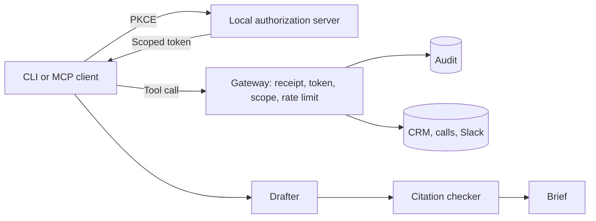

# gtm-connector

[](https://github.com/pwngh/gtm-connector/actions/workflows/test.yml?query=branch%3Amain)

A local connector that builds cited renewal briefs from CRM records, call
transcripts, and Slack threads. People use its CLI. Assistants use its MCP
(Model Context Protocol) tools. Every read needs a named scope and leaves an
audit receipt, and every line of a brief must cite the record it came from.

## Try it

The demo needs Python 3.11 or later and pipx. It uses invented data, no model,
and no external service.

```sh
pipx run --spec 'git+https://github.com/pwngh/gtm-connector.git' gtm-connector demo
```

It follows one rep preparing one renewal from CRM records, a call note, and a
Slack message. From a checkout, `./scripts/demo.sh` runs the tests and the same
demo. [Installation](docs/install.md) covers repeatable installs.
`gtm-connector --help` lists every command, and `--json` gives the
[stable output for scripts](docs/cli.md).

## What it guarantees

- **One source's grant does not open another.** CRM, calls, and Slack each need
  their own scope. A missing scope returns HTTP 403.
  [Tests](tests/test_gateway.py), [Slack tests](tests/test_slack_gateway.py)
- **A tool runs only after its audit receipt is committed.** The receipt is
  finished with the outcome afterward. If the first write fails, the tool does
  not run. [Tests](tests/test_audit.py)
- **Retrying a write does not duplicate it.** The same idempotency key and
  payload return the original activity. A changed payload returns
  `idempotency_conflict`. [Tests](tests/test_gateway.py)
- **A note cannot direct the workflow.** The brief's reads are planned in
  advance and its token is read-only. An instruction inside a note appears
  quoted and creates nothing. [Tests](tests/test_briefing.py)
- **A brief publishes only cited, supported lines.** An uncited, altered, or
  misattributed line rejects the whole draft. The checker verifies wording and
  citations, not whether a source is true. [Tests](tests/test_citations.py)
- **A selected server shows a client only the selected accounts.** With
  `serve --selection`, a client prepares a brief under its own grant, with one
  receipt per read. [Tests](tests/test_selected_sources.py)

## Use your own sources

Each source is optional and selected explicitly. Nothing falls back to demo
data silently.

| Source | Commands | Guide |
| --- | --- | --- |
| Salesforce, read-only | `salesforce check --sf-org ALIAS`, then `serve --crm-backend salesforce --sf-org ALIAS` | [Salesforce](docs/salesforce.md) |
| Call transcripts (TXT or VTT) | `calls import meeting.vtt --account acc-007` | [Calls](docs/calls.md) |
| Slack sign-in | `slack connect`, `slack status`, `slack disconnect` | [Slack sign-in](docs/slack-auth.md) |
| One Slack thread per account | `slack map`, `slack check` | [Slack threads](docs/slack-live.md) |
| Selected accounts for a client | `serve --selection selection.json` | [Selection](docs/selection.md) |

Salesforce uses an existing `sf` CLI login. Slack uses an existing public PKCE
app. Tests use invented provider responses and a fake `sf`. No live org has
been verified.

## Daily commands

```sh
gtm-connector serve --state-dir var/v2
gtm-connector doctor --state-dir var/v2
gtm-connector connect inspector --scope crm:read --state-dir var/v2
gtm-connector brief acc-007 --with-slack
gtm-connector audit --tool get_account --follow --state-dir var/v2
gtm-connector usage --state-dir var/v2
```

`serve` prints one line per tool attempt with its decision and receipt ID.
`verify` runs the guarantee checks on invented data. The Inspector CLI is
tested with an explicit local grant. Other assistant apps are untested.
[Clients](docs/clients.md), [Inspector](docs/inspector.md)

## How a request flows



The gateway commits a pending receipt, then checks the token, scope, and rate
limit. Records come back marked as untrusted data with a `record_ref`. The
drafter gets a copy of the evidence and no token or tool.

## Evaluation

The fixed evaluation compares briefs for 20 invented accounts with checked-in
expected claims. No model runs, so it measures the workflow, not model quality.

| Suite | Claims found and cited | Invented claims |
| --- | --- | --- |
| CRM and calls (`evaluate`) | 182 of 182 | 0 |
| With Slack (`evaluate --with-slack`) | 223 of 223 | 0 |

[Scoring rules](docs/evaluation.md). An optional local Ollama model can
assemble the same fixed claims. [Local model](docs/ollama.md)

## Limits

- The drafter assembles fixed claims. It does not summarize free text yet.
- Authorization is a local owner emulator. The file owner can request every
  scope and edit the stores. Audit records are not tamper-proof.
- If finishing a receipt returns HTTP 503, a write may already have committed.
  Retry with the same key. [Audit](docs/audit.md)
- It runs on macOS and Linux. There is no web interface, hosted model, or
  multi-user mode.

[Security review](SECURITY_REVIEW.md) has the full list.

## Reference

[CLI](docs/cli.md), [tools and scopes](docs/tools.md), [briefs](docs/briefs.md),
[usage report](docs/usage.md), [protocol](docs/protocol.md),
[Salesforce demo kit](docs/salesforce-demo.md), [demo Slack store](docs/slack.md),
[development](docs/development.md), [working on the code](AGENTS.md).

The server implements MCP and its authorization revision 2026-07-28 with
Python SDK 2.3.0. The checked-in companies, people, and
records are invented. MIT licensed.
