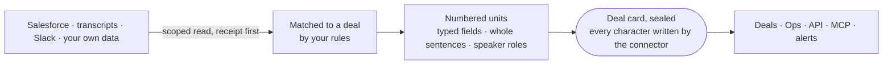

# gtm-connector

[](https://github.com/pwngh/gtm-connector/actions/workflows/test.yml?query=branch%3Amain)

**See what the CRM says about a renewal and what people actually said, side by side, with a source
behind every line.**

gtm-connector builds a Deal card for a renewal from Salesforce, call transcripts, and Slack. Every
figure, date, name, and quotation on the card points to a stored record. Each sentence is labelled
with who said it and on what basis, and the card says what it did not read. The connector writes
every character. No model does.

> **In active development.** Parts of what this page and the guides describe are still being built. The [roadmap](docs/ROADMAP.md) tracks which.

| No model | Cited | Sealed | Tested | Surfaces |
| --- | --- | --- | --- | --- |
| **0** model calls on a card | every figure and quotation numbered to its record | **SHA-256** seal on each card | **10 of 10** invented hard cases pass | web app, CLI, HTTP API, **MCP** `2026-07-28` |

### The demo

Here is the demo, on an invented law firm. Its CRM record says healthy. Three days earlier, on a
call, the customer's deputy general counsel said their general counsel will not sign until a rider
is approved. The card shows both, and where each came from.

```sh
make up      # PostgreSQL and the server, in Docker Compose
make demo    # the demo book, and the ten hard cases as ready-to-open workspaces
```

Open `https://127.0.0.1:8443/` and sign in with the demo sign-in. It runs on invented data, with no
model and no external service.

```text
DEAL CARD: "Thornfield Wren LLP" (acc-003) as of 2027-01-15
Sources read 2027-01-15T14:00:02Z.

ATTENTION, from record fields and dates
  The renewal is in 24 days and this opportunity is still open at stage "negotiation". [1][3]

RECORD VALUES, from CRM fields and connector arithmetic
  Renewal date: 2027-02-08, in 24 days [1]
  Annual recurring revenue: USD 450,000.00 [1]
  CRM risk: healthy [1]
  Account: "Thornfield Wren LLP"; industry "Legal services" [1]
  Opportunity: "Thornfield Wren LLP 2027 renewal"; stage "negotiation"; amount USD 450,000.00; close date 2027-02-01 [3]
  Contact: "Marian Holt"; role "Deputy general counsel"; email "marian@thornfield-wren.example" [2]

SAID, whole sentences as recorded; not record values
  Customer, by a speaker label equal to one contact's name
    [5] call 2027-01-12T15:00:00Z; "Marian Holt", role "Deputy general counsel" [2]
        "Our general counsel will not sign until the zero-retention and client-consent rider for AI processing is approved."
    [6] call 2027-01-12T15:00:00Z; "Marian Holt", role "Deputy general counsel" [2]
        "Please do not put a date on the order form."
  Seller, by a listed seller's name or ID
    [4] call 2027-01-12T15:00:00Z; "Morgan Reed"
        "We will have the order form countersigned by January 30."
    [7] Slack 2027-01-12T16:00:00Z; "Avery Linden"
        "Heads up [mention channel]: their general counsel will not sign until the zero-retention and client-consent rider is approved."
    [8] Slack 2027-01-12T16:00:00Z; "Avery Linden"
        "Their procurement lead mentioned USD 300,000 for a smaller seat count."
    [9] Slack 2027-01-12T16:00:00Z; "Avery Linden"
        "The redline is attached, see rider redline v4 [link files.thornfield-wren.example]."

NOT READ
  Calls: 2 call records were read. Recordings and anything outside those records were not read.
  Slack: 1 message was read. 1 attached file was not read (messages starting at [7]). Other channels were not read.
  Neutralized in source text: 1 mention, 1 link.
```

### How to read it

- **Record values** come from typed CRM fields and connector arithmetic. The seller's "January 30"
  and the second-hand "USD 300,000" are sentences someone said, so they stay under SAID.
- **A speaker role** comes from a label, never from wording. A seller is a name or ID the operator
  listed. A customer is a speaker matched to exactly one contact of the account, and the card
  prints that contact's title beside it. Anything else is unknown.
- **A quotation** is one whole sentence. A sentence too long to show is counted, never cut.
- **Source text is data.** The channel mention and the link were neutralized before anything
  displayed them, and the card says how many were.

### How the card is built



Every figure and sentence on a card carries a number. The number is a unit: one CRM record, or one
sentence of a call or a Slack message. Each resolves to its record and to the receipt of the read
that returned it, a receipt being one row of the audit log.

A card is sealed when it is published: a receipt names the SHA-256 of its bytes.

### Trace any number

```text
$ gtm-connector inspect brief-… 5
FIELD                 VALUE
Number                5
Kind                  sentence
Record                calls/call_notes/note-003b
Receipt               b63a52fb-… (read_call_notes, ok)
Text                  "Our general counsel will not sign until the zero-retention and client-consent rider for AI processing is approved."
Speaker               "Marian Holt"
Next by this speaker  6
Role                  customer (label matches contact [2])
Time                  2027-01-12T15:00:00Z
On the card           yes
Source text SHA-256   105807d2…
Neutralizer version   3
```

> **A changed card is refused.** `inspect` checks a card against its seal first, and refuses one
> that was changed.

## For sales and CS teams

1. **Your calls and Slack threads find the deal.** You do nothing.
2. **Slack alerts you when a renewal turns risky,** and says [what flagged it](docs/deals.md#what-flags-a-deal).
3. **Refresh before your call,** if you want the last few minutes.
4. **Read the Deal card,** your 30-second renewal snapshot. Click any line for its source proof, track blockers on the checklist and playbook, or ask the council what is blocking the renewal.
5. **The deal closes.** It is archived with its final card.

If your engineer has turned the matches queue on, new calls and threads wait for your OK first.
More in [working a deal](docs/deals.md).

## For RevOps and GTM engineers

1. **Write one config file,** `gtm.yaml`. It connects Salesforce, Slack, calls, and SQL or webhook push.
2. **Set auto-watch rules,** such as all open renewal opportunities closing in the next 90 days.
3. **Let the matches join their deals.** Scheduled pulls and pushed data are matched by email, domain and channel.
4. **Leave the rest to deterministic parsing and guardrails.** Whole sentences, neutralized text, speaker roles, receipts, and risk and diff rules.
5. **Auto-stop and archive.** On Closed Won or Closed Lost, polling halts and the final card is sealed.

One deal ID gets the card from the REST API, the MCP server, a webhook, a Slack alert or the web
app. More in [setting it up](docs/config.md) and [the API](docs/api.md).

## For operators

Download one binary, or run the Docker image, and give it a PostgreSQL URL. The web app is inside
the binary. More in [running it](docs/operations.md).

## What it is tested against

[Ten invented deals](tests/test_cases.py), each built to break one property. All ten pass:

| Deal | The card must |
| --- | --- |
| Contradiction | show the CRM amount and the amount a message reports, and blend neither |
| Speaker trap | keep a seller's promised date, and a seller's retelling, as the seller's |
| Missing data | print Missing for an empty field and no currency the record lacks |
| Injection | show mentions, links, and control characters as inert text, and keep a message's figure out of the record values |
| Long sentence | show a sentence whole or not at all |
| Name collision | call a speaker unknown when a seller and a contact share the name |
| Foreign number | resolve a number only inside its own card |
| Buried blocker | put a marked blocker first, above routine messages |
| Channel over the cap | count what was not read and say that more exists |
| Law-firm renewal | equal the card above, byte for byte |

## What it guarantees

- A tool runs only after its receipt is committed. A refused call still gets a receipt.
- One source's grant does not open another, and a person reads only the deals granted to them.
- A call or thread joins a deal only by a rule you configured. One that fits two deals joins neither, and both cards say so.
- A card is built only from checked evidence. Evidence that fails a check gives no card.
- A note cannot direct the workflow. An instruction inside one appears quoted and creates nothing.
- The connector writes nothing to the CRM. Alerts and webhooks are off until you configure them.
- A repeated push with the same key returns the same result.

The card shows what the records say, not whether a source is true.

## Limits

- The trial on five real renewals: its counts go here once it has run.
- The card shows up to twelve sentences, dealt by speaker role and by time, and counts the rest. Every sentence read is in `inspect` and in the proof drawer.
- A person, not wording, decides what is a blocker. A readiness rule reports what it observed in the sources it read, and unknown when a read is missing.
- A model only proposes marks. A person accepts or rejects each one.
- No live org has been verified.
- macOS and Linux. One CRM: Salesforce.

## More

- **Sales and CS:** [working a deal](docs/deals.md), [reading a Deal card](docs/python/briefs.md).
- **RevOps and GTM engineers:** [setting it up](docs/config.md), [the API](docs/api.md), [audit receipts](docs/python/audit.md).
- **Operators:** [running it](docs/operations.md), [security review](SECURITY_REVIEW.md).
- **The project:** [roadmap](docs/ROADMAP.md), [working on the code](AGENTS.md).

Until the cutover, the Python package's guides stay in `docs/`: [commands](docs/python/cli.md),
[Salesforce](docs/python/salesforce.md), [calls](docs/python/calls.md), [Slack](docs/python/slack.md),
[selection](docs/python/selection.md), [clients](docs/python/clients.md) and [tools](docs/python/tools.md).

All checked-in companies, people, and records are invented. MIT licensed.
