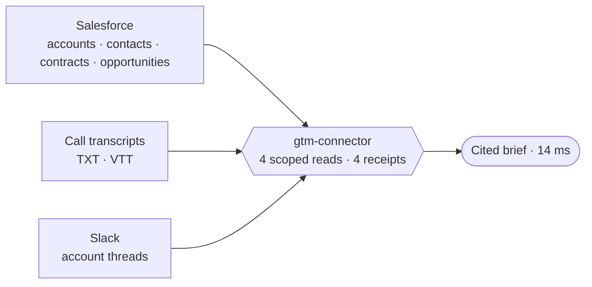

# gtm-connector

[](https://github.com/pwngh/gtm-connector/actions/workflows/test.yml?query=branch%3Amain)

A local connector that builds cited renewal briefs from CRM records, call transcripts, and Slack
threads. People use its CLI. Assistants use its MCP tools. Every read needs a named scope and leaves
an audit receipt, and every line of a brief cites the record it came from.

## Sources in, a cited brief out



One account from the built-in invented data, the same shape your own sources produce. The 14 ms is
four audited reads, the draft, the citation check, and the save, on a running server on a laptop.

**In.** Five records from three sources. Three of them disagree:

| Source | Record | What it says |
| --- | --- | --- |
| CRM | `opp-003` | stage `closed_won`, USD 25,500.00, closed 2027-01-10 |
| Call | `note-003` | "Procurement has not approved this renewal. The budget remains unsigned." |
| Slack | `msg-003` | "Security review is delayed. Procurement approval is still pending." |

**Out, 14 ms later.** Thirteen lines, every one cited. Four of them, wrapped to fit:

```text
- Renewal is in 31 days as of 2027-01-15. [crm/accounts/acc-003] [run/brief-…]

- CRM opportunity opp-003: stage "closed_won"; amount USD 25,500.00; close date 2027-01-10.
  [crm/opportunities/opp-003]

- Three-source conflict: CRM opportunity opp-003 reports stage "closed_won", call note note-003
  reports unapproved procurement, and Slack message msg-003 reports a delayed security review.
  [crm/opportunities/opp-003] [calls/call_notes/note-003] [slack/messages/msg-003]

- Proposed follow-up: Ask the account owner to confirm procurement and security review status.
  [crm/opportunities/opp-003] [calls/call_notes/note-003] [slack/messages/msg-003]
```

**When something needs attention, the brief opens with it.** Another account, `acc-002`:

```text
- Signal: renewal is in 24 days and opportunity opp-002 is still open at stage "evaluation".
  [crm/accounts/acc-002] [crm/opportunities/opp-002] [run/brief-…]

- Signal: CRM marks this account at risk: "Renewal budget is not approved.". [crm/accounts/acc-002]
```

Signals come from structured fields and dates, never from reading source text, and a draft that
omits one is rejected.

**The receipts.** One per read, committed before the read ran:

```text
get_account          ok   crm/accounts/acc-003  crm/contacts/con-003   1.2 ms
list_opportunities   ok   crm/opportunities/opp-003                    1.1 ms
read_call_notes      ok   calls/call_notes/note-003                    1.0 ms
read_slack_messages  ok   slack/messages/msg-003                       1.0 ms
```

**As data.** `brief acc-003 --with-slack --json`, condensed:

```text
{
  "brief_id":   "brief-c9f33063…",
  "account_id": "acc-003",
  "as_of":      "2027-01-15",
  "status":     "accepted",
  "text":       "- Account: \"Cedarline Analytics\". [crm/accounts/acc-003]\n…",
  "proposed_follow_up": "- Proposed follow-up: Ask the account owner to confirm procurement and …",
  "model_usage": {"model": null, "input_tokens": 0, "output_tokens": 0},
  "evidence": {
    "records":  [ 5 source records, each with its record_ref ],
    "receipts": [ 4 audit receipts, one per read ]
  }
}
```

## Measured results

Twenty invented accounts. The CRM and calls variant has 188 expected claims. The variant with Slack
has 229 and is the one the input, output, corruption, and receipt rows use. A test asserts every
count. The model row and the timings are observations from one run on an Apple M1 Max laptop.

| What | Result | Check |
| --- | --- | --- |
| Input | 98 source records through 80 audited reads | [results test](tests/test_results.py) |
| Output | 20 briefs, 229 lines, 2,579 words, 261 references | same |
| Signals raised | 6, on 4 accounts, each required and cited | [signal tests](tests/test_signals.py) |
| Lines with an evidence reference | 229 of 229 | [results test](tests/test_results.py) |
| Expected claims found and cited correctly | 188 of 188, and 229 of 229 with Slack | `gtm-connector evaluate --json`, and with `--with-slack` |
| Invented claims published | 0 | same |
| Bad lines rejected when added to a complete brief: citations removed, a citation changed, wording changed, a line repeated, an uncited sentence, a cited invention | 956 of 956 | [results test](tests/test_results.py) |
| Reads with a finished receipt | 80 of 80 | same |
| Drafts by a local model, `llama3.2`, accepted by the checker | 20 of 20, with 188 of 188 claims and 0 rejected lines, from 9,067 tokens in and 5,829 out | `gtm-connector evaluate --adapter ollama --model llama3.2:latest --json` |
| Time for 20 briefs | About 1 s without a model, 104 s with `llama3.2` | `time gtm-connector evaluate`, and with the model options above |
| Gateway time per read, as each receipt records it | 1.6 ms median, 2.2 ms at the 95th percentile | `elapsed_ms` in `gtm-connector audit --json` after a `brief` |
| Demo, from start to a finished brief | 0.9 s | `time gtm-connector demo` |

The fixed drafter and the model both assemble claims the connector derived, so these numbers measure
the pipeline and the checker, not free-text summarizing.

## Try it

Python 3.11 or later and pipx. Invented data, no model, no external service.

```sh
pipx run --spec 'git+https://github.com/pwngh/gtm-connector.git' gtm-connector demo
```

One rep prepares one renewal from CRM records, a call note, and a Slack message. `pipx install` with
the same source keeps the command on your PATH. From a checkout, `./scripts/demo.sh` installs the
pinned dependencies, runs the tests, and runs the demo.
`gtm-connector --help` lists every command, and `--json` gives [stable output](docs/cli.md).

## What it guarantees

| Guarantee | Tests |
| --- | --- |
| One source's grant does not open another. A direct call without the scope returns HTTP 403. | [gateway](tests/test_gateway.py), [Slack](tests/test_slack_gateway.py) |
| A tool runs only after its audit receipt is committed. | [audit](tests/test_audit.py), [gateway](tests/test_gateway.py) |
| Retrying a write with the same key does not duplicate it. | [gateway](tests/test_gateway.py) |
| A note cannot direct the workflow. An instruction inside one appears quoted and creates nothing. | [briefing](tests/test_briefing.py) |
| A brief publishes only cited, supported lines. One bad line rejects the draft. | [citations](tests/test_citations.py) |
| With `serve --selection`, a client reads only the selected accounts, under its own grant. A source it lacks the scope for is disclosed as denied in the brief. | [selection](tests/test_selected_sources.py) |

The checker verifies wording and citations, not whether a source is true.

## Use your own sources

Each source is selected explicitly. Nothing falls back to demo data.

| Source | Commands | Guide |
| --- | --- | --- |
| Salesforce, read-only | `salesforce check --sf-org ALIAS`, `serve --crm-backend salesforce --sf-org ALIAS` | [Salesforce](docs/salesforce.md) |
| Call transcripts (TXT, VTT) | `calls import meeting.vtt --account acc-007` | [Calls](docs/calls.md) |
| Slack sign-in | `slack connect`, `slack status`, `slack disconnect` | [Slack sign-in](docs/slack.md) |
| One Slack thread per account | `slack map`, `slack check` | [Slack threads](docs/slack.md) |
| Selected accounts for a client | `serve --selection selection.json` | [Selection](docs/selection.md) |

Salesforce uses an existing `sf` CLI login. Slack uses an existing public PKCE app. Tests use
invented provider responses. No live org has been verified.

## Daily commands

```sh
gtm-connector serve --state-dir var/v2
gtm-connector connect inspector --scope crm:read --state-dir var/v2
gtm-connector brief acc-007 --with-slack --state-dir var/brief   # its own folder while serve runs
gtm-connector audit --tool get_account --follow --state-dir var/v2
gtm-connector doctor --state-dir var/v2
```

`serve` prints one line per tool attempt with its decision and receipt ID. The Inspector CLI is the
tested client. Other assistant apps are untested. [Clients](docs/clients.md)

## Limits

- The drafter assembles fixed claims. It does not summarize free text yet.
- Authorization is a local owner emulator. The file owner can request every scope and edit the
  stores. Audit records are not tamper-proof. [Security review](SECURITY_REVIEW.md)
- macOS and Linux. No web interface, hosted model, or multi-user mode.

More: [commands and output](docs/cli.md), [tools, scopes, and protocol](docs/tools.md),
[briefs, evaluation, and local models](docs/briefs.md), [audit and usage](docs/audit.md),
[clients and Inspector](docs/clients.md), [working on the code](AGENTS.md).

MCP revision 2026-07-28, Python SDK 2.3.0. All checked-in companies, people, and records are
invented. MIT licensed.
