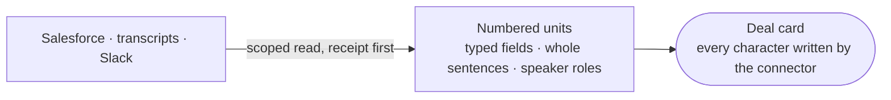

# gtm-connector

[](https://github.com/pwngh/gtm-connector/actions/workflows/test.yml?query=branch%3Amain)

A Deal card for a renewal, built from Salesforce, call transcripts, and Slack. It prints no figure,
date, name, or quotation it cannot point to in a stored record. It labels who said each sentence and
on what basis, and it says what it did not read. No model writes any of it.

`gtm-connector demo`, on an invented law firm whose CRM record looks healthy:

```text
DEAL CARD: "Thornfield Wren LLP" (acc-003) as of 2027-01-15
Sources read 2027-01-15T14:00:02Z.

ATTENTION, from record fields and dates
  The renewal is in 24 days and this opportunity is still open at stage "negotiation". [1][3]

RECORD VALUES, from CRM fields and connector arithmetic
  Renewal date: 2027-02-08, in 24 days [1]
  Annual recurring revenue: USD 450,000.00 [1]
  CRM risk: healthy [1]
  Account: "Thornfield Wren LLP"; industry "Legal services" [1]
  Opportunity: "Thornfield Wren LLP 2027 renewal"; stage "negotiation"; amount USD 450,000.00; close date 2027-02-01 [3]
  Contact: "Marian Holt"; role "Deputy general counsel"; email "marian@thornfield-wren.example" [2]

SAID, whole sentences as recorded; not record values
  Customer, by a speaker label equal to one contact's name
    [5] call 2027-01-12T15:00:00Z; "Marian Holt", role "Deputy general counsel" [2]
        "Our general counsel will not sign until the zero-retention and client-consent rider for AI processing is approved."
    [6] call 2027-01-12T15:00:00Z; "Marian Holt", role "Deputy general counsel" [2]
        "Please do not put a date on the order form."
  Seller, by a listed seller's name or ID
    [4] call 2027-01-12T15:00:00Z; "Morgan Reed"
        "We will have the order form countersigned by January 30."
    [7] Slack 2027-01-12T16:00:00Z; "Avery Linden"
        "Heads up [mention channel]: their general counsel will not sign until the zero-retention and client-consent rider is approved."
    [8] Slack 2027-01-12T16:00:00Z; "Avery Linden"
        "Their procurement lead mentioned USD 300,000 for a smaller seat count."
    [9] Slack 2027-01-12T16:00:00Z; "Avery Linden"
        "The redline is attached, see rider redline v4 [link files.thornfield-wren.example]."

NOT READ
  Calls: 2 call records were read. Recordings and anything outside those records were not read.
  Slack: 1 message was read. 1 attached file was not read (messages starting at [7]). Other channels were not read.
  Neutralized in source text: 1 mention, 1 link.
```

- **Record values** come from typed CRM fields and connector arithmetic. The seller's "January 30"
  and the second-hand "USD 300,000" are sentences someone said, so they stay under SAID.
- **A speaker role** comes from a label, never from wording. A seller is a name or ID the operator
  listed. A customer is a speaker label equal to the name of exactly one contact of the account, and
  the card prints that contact's title beside it. Anything else is unknown. A label is what the
  source wrote: it does not prove who spoke.
- **A quotation** is one whole sentence. A sentence too long to show is counted, never cut.
- **Source text is data.** The channel mention and the link were neutralized before anything
  displayed them, and the card says how many were.



Every number on a card resolves to its record and the receipt of the read that returned it.
`gtm-connector inspect brief-…` lists every unit of the card, one per line, and a number shows one:

```text
$ gtm-connector inspect brief-… 5
FIELD                 VALUE
Number                5
Kind                  sentence
Record                calls/call_notes/note-003b
Receipt               b63a52fb-… (read_call_notes, ok)
Text                  "Our general counsel will not sign until the zero-retention and client-consent rider for AI processing is approved."
Speaker               "Marian Holt"
Next by this speaker  6
Role                  customer (label matches contact [2])
Time                  2027-01-12T15:00:00Z
On the card           yes
Source text SHA-256   105807d2…
Neutralizer version   3
```

## What it is tested against

[Ten invented deals](tests/test_cases.py), each built to break one property. These pass today:

| Deal | The card must |
| --- | --- |
| Contradiction | show the CRM amount and the amount a message reports, and blend neither |
| Speaker trap | keep a seller's promised date, and a seller's retelling, as the seller's |
| Missing data | print Missing for an empty field and no currency the record lacks |
| Injection | show mentions, links, and control characters as inert text, and keep a message's figure out of the record values |
| Long sentence | show a sentence whole or not at all |
| Name collision | call a speaker unknown when a seller and a contact share the name |
| Foreign number | resolve a number only inside its own card |
| Law-firm renewal | equal the card above, byte for byte |

## Try it

Python 3.11 or later and pipx. Invented data, no model, no external service.

```sh
pipx run --spec 'git+https://github.com/pwngh/gtm-connector.git' gtm-connector demo
```

`pipx install` with the same source keeps the command on your PATH. From a checkout,
`./scripts/demo.sh` installs the pinned dependencies, runs the tests, and runs the demo.
`gtm-connector --help` lists the seven commands and `debug`, which holds the rest. `--json`, before or
after a command, gives [stable output](docs/cli.md).

## Use your own sources

Connect each source once. Every other command then reads what is connected and takes no source
option. A source you have not connected is stated as not connected on the card, and nothing falls
back to demo data.

```sh
gtm-connector connect salesforce --org ALIAS --seller 'Morgan Reed'
gtm-connector connect calls
gtm-connector connect status
gtm-connector accounts --query Thornfield
gtm-connector brief ACCOUNT_ID
```

| Source | Commands | Guide |
| --- | --- | --- |
| Salesforce, read-only | `debug salesforce check --sf-org ALIAS`, `connect salesforce --org ALIAS` | [Salesforce](docs/salesforce.md) |
| Call transcripts (TXT, VTT, SRT) | `connect calls`, `debug calls import meeting.vtt --account acc-007` | [Calls](docs/calls.md) |
| Slack sign-in | `debug slack connect`, `connect slack`, `debug slack status`, `debug slack disconnect` | [Slack sign-in](docs/slack.md) |
| One Slack thread per account | `debug slack map`, `debug slack check` | [Slack threads](docs/slack.md) |
| Selected accounts for a client | `debug serve --selection selection.json` | [Selection](docs/selection.md) |
| Invented data | `connect demo` | [Commands](docs/cli.md) |

Transcripts and Slack threads are added one at a time with `debug calls import` and `debug slack map`.
Transcript folders and a Slack channel window are on the [roadmap](docs/ROADMAP.md).

Salesforce uses an existing `sf` CLI login. Slack uses an existing public PKCE app. Tests use
invented provider responses. No live org has been verified.

## Daily commands

```sh
gtm-connector connect status
gtm-connector accounts --query Thornfield
gtm-connector brief acc-003
gtm-connector inspect brief-REPLACE                 # every unit of that card, one per line
gtm-connector inspect brief-REPLACE 5               # one number: its record and receipt
gtm-connector inspect acc-003                       # the account and its newest card
gtm-connector audit --tool get_account --follow
```

An assistant app needs `debug serve` running in its folder, for the HTTP transport and for the stdio
bridge. One process holds a folder at a time, so while it runs, connect a second folder for `brief`:

```sh
gtm-connector debug serve
gtm-connector connect inspector --scope crm:read
gtm-connector brief acc-003 --state-dir var/brief   # a second connected folder while debug serve runs
gtm-connector debug doctor
```

`debug serve` prints one line per tool attempt with its decision and receipt ID. The Inspector CLI is
the tested client. Other assistant apps are untested. [Clients](docs/clients.md)

## What it guarantees

| Guarantee | Tests |
| --- | --- |
| One source's grant does not open another. A direct call without the scope returns HTTP 403. | [gateway](tests/test_gateway.py), [Slack](tests/test_slack_gateway.py) |
| A tool runs only after its audit receipt is committed. | [audit](tests/test_audit.py), [gateway](tests/test_gateway.py) |
| Retrying a write with the same key does not duplicate it. | [gateway](tests/test_gateway.py) |
| A note cannot direct the workflow. An instruction inside one appears quoted and creates nothing. | [briefing](tests/test_briefing.py) |
| A card is built only from checked evidence. A record of another account or a missing receipt gives no card. | [units](tests/test_units.py) |
| With `debug serve --selection`, a client reads only the selected accounts, under its own grant. A source it lacks the scope for is stated as not read on the card. | [selection](tests/test_selected_sources.py) |

The card shows what the records say, not whether a source is true.

## The Go server (in progress)

The Go program at the root serves a read-only evidence API and the web app over HTTPS, on PostgreSQL.
It reads only the invented demo book so far, and `make demo` publishes its cards. It needs Docker
with Compose (Docker Desktop, or Colima with `docker-compose`). The [roadmap](docs/ROADMAP.md) lists
what is left before it replaces the Python package.

```sh
make dev                        # PostgreSQL in Compose, the server on this machine (needs Go and Node)
make up                         # PostgreSQL and the server in Compose
make demo                       # a card for each demo account, read by the demo sign-in
make down                       # stop; the database and credentials are kept
make backup                     # the database and the credentials folder, into one file
make restore BACKUP=gtm-....tar.gz   # into an empty database (make clean deletes the database)
make test                       # go vet and the Go tests against the Compose database
```

Add `POSTGRES=18.7` to any of these to use the pinned fallback PostgreSQL, on its own volume.

`make dev` and `make test` need Go 1.27.4, and `make dev` Node 22.23.4 (`nvm use` reads `.nvmrc`); both
refuse other versions. `pins.json` lists every pinned version and digest, from the toolchains and images
to the CI actions, and a test fails when the Dockerfile, `compose.yaml`, the Makefile or CI uses another.
`gtm-connector version` prints the commit a binary was built from. An image that `make up` builds carries
it as the label `org.opencontainers.image.revision`, ending in `-modified` if the checkout had changes.

`make verify-real` downloads public meeting, call, chat and CRM datasets into `~/.cache/gtm-connector/real`
and checks them against pinned digests, then runs every utterance and message through the Python package
and the Go port and compares their sentences, neutralized text, scanners and JSON parsing. It reports
counts, positions and digests, never text. Nothing real is committed, and CI never runs it.
[Real data](docs/real-data.md)

Open `https://127.0.0.1:8443/`; `localhost` redirects there. The first run writes `.env` (mode 0600,
with random passwords for two database roles) and a private credentials folder,
`~/.config/gtm-connector/credentials` (mode 0700, files 0600): the owner secret, the session key, the
local TLS certificate and key, and the demo sign-in in `demo-credentials.json`. Setup, backup and
restore connect as the database owner; the server connects as an app role that reads and writes rows
and cannot change the schema or switch off a check. Browsers do not separate cookies by port, so
another HTTPS server on `127.0.0.1` would see this one's cookies.

`make demo` (or `gtm-connector demo` after setup, as the app role) loads the invented demo book into the
demo workspace, grants the demo sign-in its 30 accounts, and makes and publishes each account's card
through the Go card maker on PostgreSQL, under receipts. Each card is the one the Python package makes for
that account, apart from its brief and receipt IDs, its token fingerprint and its read times. A run
publishes only for accounts that hold no card, so running it again finishes a run that stopped part way;
`demo --again` publishes another card for every account. Cards and receipts are never deleted. A grant
someone revoked stays revoked, and its account gets no card. Signed in, the server lists the accounts at
`/api/v1/accounts` and their cards at `/api/v1/accounts/ACCOUNT/cards`. Demo data and a real source never
share a workspace: the database refuses a real connection in the demo workspace.

Backups go to `~/.config/gtm-connector/backups`. A backup's digests detect corruption only: they
are stored in the backup itself, so they do not prove who made it. A restore needs an empty
database, and each credential must be absent or the same as the backup's. It refuses any row the
server would refuse on writing, such as a card whose seal does not name its bytes. If a restore
stops after the database is in, run the same command again to finish it; until then, setup, the server and `demo` refuse to
start and say to run the restore again. On Colima, if a port does not answer, the Makefile forwards it with
`scripts/colima-forward.sh`.

## Limits

- Nothing here was tried on a real deal. The cases test correctness on invented data, not usefulness.
- The card shows up to twelve sentences, dealt by speaker role and by time, and counts the rest. It
  does not rank them or relate one to another, so on a long call the sentence that matters may be
  among those counted. Every sentence read is in `inspect BRIEF_ID` and `brief --json`.
- A seller is whoever you list with `connect ... --seller NAME`. Slack authors are never shown as
  customers.
- Authorization is a local owner emulator. The file owner can request every scope and edit the
  stores. Audit records are not tamper-proof. [Security review](SECURITY_REVIEW.md)
- macOS and Linux. No hosted model or multi-user mode.
- `web/` is a prototype of the renewal workflow on invented data. Served by the Go server, its
  Evidence and Readiness pages sign in a demo principal and read sealed cards from `/api/v1`; Readiness
  shows the sources a card did not read or show as open items, and the server has no workflow rules yet.
  `scripts/api-browser.mjs` tests both pages in a browser against a stub of the API. Everything else, and every page
  when it runs alone, is a walkthrough whose state lives in the browser, and whose reviews and
  approvals are demonstrations, not authorization. Run it alone with `npm ci`, `npm test`, and
  `npm run dev` inside `web/`.

More: [commands and output](docs/cli.md), [tools, scopes, and protocol](docs/tools.md),
[Deal cards](docs/briefs.md), [audit](docs/audit.md),
[clients and Inspector](docs/clients.md), [roadmap](docs/ROADMAP.md), [working on the code](AGENTS.md).

MCP revision 2026-07-28, Python SDK 2.3.0. All checked-in companies, people, and records are
invented. MIT licensed.
