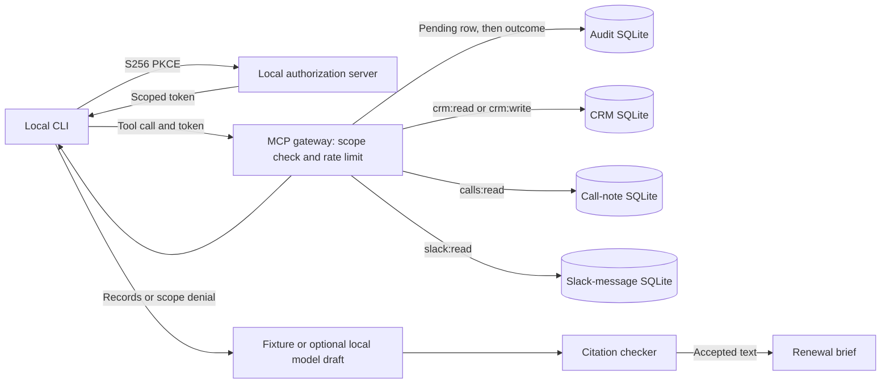

# GTM connector demo

This is an MCP server in front of a mock CRM, call notes, and Slack account
messages. It gives clients scoped access, records recognized tool calls in an
audit log, and drafts renewal briefs that cite the source or audit record behind
each statement.

A rep who gets one wrong answer about an account stops opening the tool. The
checker rejects any line it cannot tie to a record. The tests below prove the
permission checks, audit boundary, write retries, and rejection of unsupported
claims.

Run `./scripts/demo.sh` from a clean checkout. It installs dependencies, runs
the tests, and shows those cases on invented data. The first install needs
internet; the default runtime needs no external service or key.

## What it guarantees

The default demo uses a fixed drafting step. An optional local Ollama model
can assemble a candidate from the same supported claims. Both paths pass through
the same checker. It verifies wording and citations, not whether a source is true.

- **Source permissions stay separate.** CRM, call notes, and Slack messages
  require independent grants. Scope denials return HTTP 403.
  [Scope tests](tests/test_gateway.py#L182), [Slack scope tests](tests/test_slack_gateway.py)
- **Execution depends on an audit receipt.** The gateway commits a `pending`
  row before running a tool, then finalizes that row. If the first write fails,
  the tool does not run. Unparseable traffic with no tool-call marker and
  requests disconnected before execution fall outside the receipt guarantee.
  [Receipt test](tests/test_audit.py#L25),
  [failure test](tests/test_gateway.py#L373)
- **Retries do not duplicate an activity.** The same idempotency key and payload
  return the original activity. A changed payload returns
  `idempotency_conflict`. [Write test](tests/test_gateway.py#L293)
- **Note instructions stay data.** The fixed workflow has a read-only token.
  It quotes the injected note, makes its three planned reads, and creates no
  activity. This tests the workflow boundary without a model interpreting text.
  [Injection test](tests/test_briefing.py#L134)
- **Published claims need matching evidence.** The checker rejects uncited,
  altered, or misattributed statements. It also requires the known conflict flag
  to cite both records. [Citation tests](tests/test_citations.py#L54),
  [conflict test](tests/test_citations.py#L150)

## See it

These lines were captured for `acc-003`. The fixed demo date `2027-01-15`
keeps renewal calculations repeatable; it is not the execution date.

```text
- CRM opportunity opp-003: stage "closed_won"; amount USD 25,500.00; close date 2027-01-10. [crm/opportunities/opp-003]
- Untrusted call note note-003 at "2027-01-12T15:00:00Z" says "Procurement has not approved this renewal. The budget remains unsigned.". [calls/call_notes/note-003]
- Source conflict: CRM opportunity opp-003 reports stage "closed_won", while call note note-003 reports unapproved procurement. [crm/opportunities/opp-003] [calls/call_notes/note-003]
```

Record claims cite `crm/...` or `calls/call_notes/...`. Empty query results
and call-note scope denials cite the relevant `audit/...` receipt. Renewal-day
calculations also cite the saved `run/...` date.

The checker accepted the captured brief. Appending `The renewal was approved.`
made it exit with code `2`, print nothing to stdout, and return:

```text
error: Brief contains an uncited, unsupported, or misattributed statement.
```

<details>
<summary>Inspect a real call-note receipt</summary>

This is the complete receipt from the captured brief. `token_id` is a SHA-256
fingerprint, not a reusable bearer token. IDs and timestamps vary per run.

```json
{
  "audit_id": "9684fab8-5e7e-41a8-86e5-dec22e774624",
  "started_at": "2026-11-17T19:56:52.314305Z",
  "token_id": "905a643f389384f2267fb155184c25fce82d1b69ee91b8b140795b4c0d28454b",
  "tool": "read_call_notes",
  "arguments": {
    "account_id": "acc-003"
  },
  "request_id": 3,
  "brief_id": "brief-008c10f70b2c4d05ad78368d22a2568f",
  "status": "ok",
  "http_status": 200,
  "row_count": 1,
  "rows": [
    "calls/call_notes/note-003"
  ],
  "elapsed_ms": 3.656832966953516,
  "error": null
}
```

</details>

### Fixture evaluation

The evaluation compares 20 fixed accounts with checked-in expected claims.
Each displayed claim line counts once, including compound contact and opportunity
statements.

Measured on 2026-11-17 with `.venv/bin/python -m gtm_connector evaluate`.
The adapter is `fixture`; the model is `null` because no model runs.

| Measure | Result |
| --- | --- |
| Accounts with accepted briefs | 20 / 20 |
| Expected claims found | 182 / 182 |
| Claims cited correctly | 182 / 182 |
| Invented claims | 0 of 182 emitted claims |

The 182 of 182 counts measure fixed claim lines found and cited correctly
against fixed expected answers. The drafter and checker share supported wording;
these scores do not measure model quality. The run recorded 60 successful audit
receipts, zero activities, and zero model tokens.
[Results](evaluation/RESULTS.json)
[Expected claims](evaluation/expected.json)
[Scoring rules](docs/evaluation.md)

### Local model measurement

The optional drafter ran `llama3.2:latest` through Ollama 0.30.0 on 2026-11-17,
from `20:51:09` to `20:53:23` UTC. The response identified the model as
`llama3.2:latest:local`. The request used the local-only selector.

```sh
.venv/bin/python -m gtm_connector evaluate --adapter ollama --model llama3.2:latest
```

| Measure | Fixture baseline | Local model |
| --- | --- | --- |
| Accepted briefs | 20 / 20 | 20 / 20 |
| Published claims found and cited | 182 / 182 | 182 / 182 |
| Rejected briefs | 0 | 0 |
| Unsupported published claims | 0 | 0 |
| Reported input / output tokens | 0 / 0 | 3384 / 5500 |

The model emitted 182 candidate lines. All 20 candidates were scored. The checker
rejected zero lines in this run. This proves local inference passed through the
gate; it does not prove the model hallucinated or that a hallucination was caught.
The task is fixed-claim assembly. Adverse tests separately reject uncited,
invented, miscited, duplicate, and action-shaped candidates without publishing
any part of the failed brief.
[Model results and exact command](evaluation/RESULTS_OLLAMA.json)
[Rejection tests](tests/test_model_workflow.py)
[Local model limits](docs/ollama.md)

## Request path



The client names a tool and supplies its arguments. The local authorization
server issues a token with named permissions, called scopes. CRM, calls, and
Slack each need their own grant.

The gateway writes a pending audit receipt, then checks the token, scope, and
rate limit. A receipt records the attempt and its outcome. A rejected call
stops there. An allowed tool reads its source and returns records marked as
untrusted data, with a `record_ref` for each record. The gateway finalizes the
receipt before returning the result.

The briefing workflow requests read scopes only. The default brief has three
receipts. `--with-slack` adds a fourth read and a checked follow-up draft.

The workflow saves the returned records and receipts as an evidence snapshot.
The drafter gets a copy of that evidence. It has no token or tool interface.
The checker compares each candidate line with supported wording and its exact
references. Only a brief that passes the whole check is published.

An empty source result and a denied grant are different outcomes. The brief
states which occurred and cites the receipt. Other read failures stop the brief.
A failed citation check rejects the whole draft; it does not publish the lines
that happened to pass. Saved evidence lets the operator check another candidate
against the same records later.

## Run it

From a clean checkout:

```sh
./scripts/demo.sh
```

Requires macOS or Linux and Python 3.11+ with SQLite and venv support. The first
dependency install needs internet. The runtime needs no external service,
account, model, or API key. The script runs the test suite and two local HTTPS services.

With 30 invented accounts and reserved `.example` addresses, it demonstrates
HTTP 403 scope denial, HTTP 429 rate limiting, deduplicated writes, and zero
writes from the injected note. It creates 14 connector receipts and nine briefing
receipts, then stops both services. State stays in the gitignored `var/v2` directory.

For the full walkthrough, including evaluation, usage, and a live citation
rejection:

```sh
./scripts/five-minute-demo.sh
```

It prints its private output directory. Follow [the five-minute guide](DEMO.md).

### Use an external MCP client

The optional [Inspector walkthrough](docs/inspector.md) starts the server and
creates a private config with explicitly granted scopes. After that setup:

```sh
NODE_EXTRA_CA_CERTS="$PWD/var/inspector/tls.pem" npx --yes @modelcontextprotocol/inspector@2.15.0 --cli --config var/inspector/inspector.json --server gtm-connector --stored-auth-only --quiet --format json --method tools/list
```

Inspector 2.15.0 discovers MCP 2026-07-28, lists all six tools, and reads the three
sources through the existing gateway. The [integration check](scripts/check-inspector.py)
proves every pair of source grants stays separate, HTTP 429, HTTP 401, and one receipt per tool
attempt. Node and npm downloads are needed only for this optional client check.

### Use a local model

With Ollama running and a local model already installed:

```sh
.venv/bin/python -m gtm_connector brief acc-003 --adapter ollama --model llama3.2:latest --json
.venv/bin/python -m gtm_connector evaluate --adapter ollama --model llama3.2:latest
```

The adapter never downloads a model or calls a hosted service. It rejects cloud
aliases. The model receives supported claims from the authorized evidence, with
no credentials or tool access. Any invalid line rejects the entire draft.
[Setup, measurements, and limits](docs/ollama.md)

### Include account-channel context

```sh
.venv/bin/python -m gtm_connector brief acc-003 --with-slack --json
.venv/bin/python -m gtm_connector evaluate --with-slack
```

This adds a `slack:read` grant, a fourth audited read, and `proposed_follow_up`
copied from the checked brief. The `acc-003` fixture flags the CRM, call-note,
and Slack disagreement with all three references. The proposal sends nothing.
[Slack fixtures, denial cases, and limits](docs/slack.md)

Measured on 2026-11-17 at `21:11:19` UTC with the fixture adapter and no model:
the extended evaluation found and correctly cited 223 of 223 claims, with zero
invented claims, 80 audit receipts, and zero activities.
[Exact command and results](evaluation/RESULTS_SLACK.json)

### Read a Salesforce Developer Edition org

After setting `SALESFORCE_INSTANCE_URL` and `SALESFORCE_ACCESS_TOKEN` privately:

```sh
.venv/bin/python -m gtm_connector serve --crm-backend salesforce --state-dir var/salesforce
```

This replaces the three CRM read tools with Salesforce REST queries. It checks
Developer Edition before reading account data. `log_activity` is unavailable;
call notes and Slack remain separate mocks. The adapter does not map renewal
fields, so it refuses brief generation. Tests use invented HTTP responses.
No live org has been verified. [Setup, field mapping, and limits](docs/salesforce.md)

## What the mocks stand for

| Mock | What it represents |
| --- | --- |
| CRM store | The account, contact, deal, renewal, and activity records a sales team keeps. |
| Call-note store | Notes a call-recording service would attach to those accounts. This fixture stores text only. |
| Slack-message store | Internal account-channel messages about a renewal. This fixture has no connection to Slack. |

## Limits worth reading

- The default drafter is a deterministic fixture. Its score measures that
  workflow, not model quality. Optional Ollama drafting assembles fixed claims;
  it does not support unrestricted summaries.
- The checker accepts fixed wording and permits some omissions. Missing notes
  and recognized conflicts must stay visible. Slack mode also requires its
  empty or denied outcome and a cited follow-up proposal. [Brief limits](docs/briefs.md)
- Authorization uses a local owner emulator. The file owner can request every
  scope and alter the stores. Retention is manual. Audit records and snapshots
  are not tamper-proof; snapshot writes are not atomic.
  [Security review](SECURITY_REVIEW.md)
- Audit finalization can return HTTP 503 after a committed write. Retry the same
  key and reconcile any pending row. The audit CLI can initialize its table and
  change file permissions. [Audit details](docs/audit.md)
- Read-only usage reporting groups credentials, tools, and UTC days. Rejected
  credentials and `anonymous` count too. Unknown model usage stays `null`, and
  totals cover saved snapshots only. [Usage details](docs/usage.md)
- MCP and authorization revision: **2026-07-28**, read **2026-11-17**. Python SDK:
  **2.3.0**. The included client and Inspector CLI 2.15.0 are tested. Other
  assistant applications and interactive external login are unverified.
  [Protocol details](docs/protocol.md)

The following exclusions describe the default fixture runtime. The explicitly
selected Salesforce read adapter is described above.

Custom Python adapters are not sandboxed or selectable through the CLI. No
hosted model adapter, real CRM or call-recording integration, web interface,
or multi-tenant behavior is included.

## Reference

[Tools and fixture data](docs/tools.md)
[Design decisions](DECISIONS.md)
[Rules the coding agents worked under](AGENTS.md)

Portfolio project for Preston Neal. The checked-in fixture records use synthetic
labels. Optional Salesforce reads return records from the operator's org.

MIT licensed.
