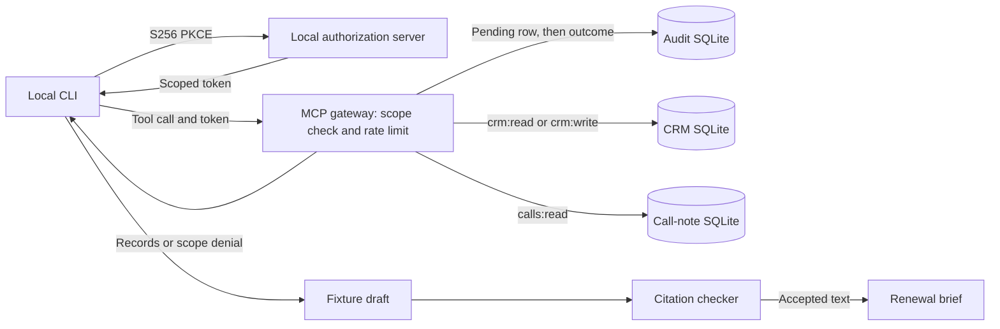

# GTM connector demo

An MCP server sits in front of a mock CRM and call notes, with scoped tokens,
an audit log of every tool call, and a workflow that drafts a renewal brief and
cites the record behind each statement. A rep who gets one wrong answer about
an account stops opening the tool, so the checker rejects any line it cannot
tie to a record.

## What it guarantees

This portfolio demo uses a fixed drafting step. No model runs. The checker
verifies supported wording and citations. It cannot establish whether a source
is true.

- **Source permissions stay separate.** CRM access does not grant call-note
  access, or vice versa. Scope denials return HTTP 403.
  [Scope tests](tests/test_gateway.py#L182)
- **Execution depends on an audit receipt.** The gateway commits a `pending`
  row before running a tool, then finalizes that row. If the first write fails,
  the tool does not run. Unparseable traffic with no tool-call marker and
  requests disconnected before execution fall outside the receipt guarantee.
  [Receipt test](tests/test_audit.py#L25),
  [failure test](tests/test_gateway.py#L373)
- **Retries do not duplicate an activity.** The same idempotency key and payload
  return the original activity. A changed payload returns
  `idempotency_conflict`. [Write test](tests/test_gateway.py#L293)
- **Note instructions stay data.** The fixed workflow has a read-only token.
  It quotes the injected note, makes its three planned reads, and creates no
  activity. This tests the workflow boundary without a model interpreting text.
  [Injection test](tests/test_briefing.py#L134)
- **Published claims need matching evidence.** The checker rejects uncited,
  altered, or misattributed statements. It also requires the known conflict flag
  to cite both records. [Citation tests](tests/test_citations.py#L54),
  [conflict test](tests/test_citations.py#L150)

## See it

These lines were captured for `acc-003`. The fixed demo date `2027-01-15`
keeps renewal calculations repeatable; it is not the execution date.

```text
- CRM opportunity opp-003: stage "closed_won"; amount USD 25,500.00; close date 2027-01-10. [crm/opportunities/opp-003]
- Untrusted call note note-003 at "2027-01-12T15:00:00Z" says "Procurement has not approved this renewal. The budget remains unsigned.". [calls/call_notes/note-003]
- Source conflict: CRM opportunity opp-003 reports stage "closed_won", while call note note-003 reports unapproved procurement. [crm/opportunities/opp-003] [calls/call_notes/note-003]
```

Record claims cite `crm/...` or `calls/call_notes/...`. Empty query results
and call-note scope denials cite the relevant `audit/...` receipt. Renewal-day
calculations also cite the saved `run/...` date.

The checker accepted the captured brief. Appending `The renewal was approved.`
made it exit with code `2`, print nothing to stdout, and return:

```text
error: Brief contains an uncited, unsupported, or misattributed statement.
```

<details>
<summary>Inspect a real call-note receipt</summary>

This is the complete receipt from the captured brief. `token_id` is a SHA-256
fingerprint, not a reusable bearer token. IDs and timestamps vary per run.

```json
{
  "audit_id": "9684fab8-5e7e-41a8-86e5-dec22e774624",
  "started_at": "2026-11-17T19:56:52.314305Z",
  "token_id": "905a643f389384f2267fb155184c25fce82d1b69ee91b8b140795b4c0d28454b",
  "tool": "read_call_notes",
  "arguments": {
    "account_id": "acc-003"
  },
  "request_id": 3,
  "brief_id": "brief-008c10f70b2c4d05ad78368d22a2568f",
  "status": "ok",
  "http_status": 200,
  "row_count": 1,
  "rows": [
    "calls/call_notes/note-003"
  ],
  "elapsed_ms": 3.656832966953516,
  "error": null
}
```

</details>

### Fixture evaluation

The evaluation compares 20 fixed accounts with checked-in expected claims.
Each displayed claim line counts once, including compound contact and opportunity
statements.

Measured on 2026-11-17 with `.venv/bin/python -m gtm_connector evaluate`.
The adapter is `fixture`; the model is `null` because no model runs.

| Measure | Result |
| --- | --- |
| Accounts with accepted briefs | 20 / 20 |
| Expected claims found | 182 / 182 |
| Claims cited correctly | 182 / 182 |
| Invented claims | 0 of 182 emitted claims |

The 182 of 182 counts measure fixed claim lines found and cited correctly
against fixed expected answers. The drafter and checker share supported wording;
these scores do not measure model quality. The run recorded 60 successful audit
receipts, zero activities, and zero model tokens.
[Results](evaluation/RESULTS.json) · [Expected claims](evaluation/expected.json) ·
[Scoring rules](docs/evaluation.md)

## Request path



The briefing workflow requests read scopes only. Each completed brief has three
receipts, one for each planned read.

## Run it

From a clean checkout:

```sh
./scripts/demo.sh
```

Requires macOS or Linux and Python 3.11+ with SQLite and venv support. The first
dependency install needs internet. The runtime needs no external service,
account, model, or API key. The script runs 116 tests and two local HTTPS services.

With 30 invented accounts and reserved `.example` addresses, it demonstrates
HTTP 403 scope denial, HTTP 429 rate limiting, deduplicated writes, and zero
writes from the injected note. It creates 14 connector receipts and nine briefing
receipts, then stops both services. State stays in the gitignored `var/v2` directory.

For the full walkthrough, including evaluation, usage, and a live citation
rejection:

```sh
./scripts/five-minute-demo.sh
```

It prints its private output directory. Follow [the five-minute guide](DEMO.md).

## What the mocks stand for

| Mock | What it represents |
| --- | --- |
| CRM store | The account, contact, deal, renewal, and activity records a sales team keeps. |
| Call-note store | Notes a call-recording service would attach to those accounts. This fixture stores text only. |

## Limits worth reading

- No model drafts these briefs. A deterministic fixture produces the text.
  The score measures that fixture workflow, not model quality.
- The checker accepts fixed wording and permits some omissions. Missing notes
  and the exact procurement conflict must stay visible. [Brief limits](docs/briefs.md)
- Authorization uses a local owner emulator. The file owner can request every
  scope and alter the stores. Retention is manual. Audit records and snapshots
  are not tamper-proof; snapshot writes are not atomic.
  [Security review](SECURITY_REVIEW.md)
- Audit finalization can return HTTP 503 after a committed write. Retry the same
  key and reconcile the pending row. The audit CLI can initialize its table and
  change file permissions. [Audit details](docs/audit.md)
- Read-only usage reporting groups credentials, tools, and UTC days. Rejected
  credentials and `anonymous` count too. Unknown model usage stays `null`, and
  totals cover saved snapshots only. [Usage details](docs/usage.md)
- MCP and authorization revision: **2026-07-28**, read **2026-11-17**. Python SDK:
  **2.3.0**. Only the included client is tested. [Protocol details](docs/protocol.md)

Custom Python adapters are not sandboxed or selectable through the CLI. No
hosted model adapter, real CRM or call-recording integration, web interface,
or multi-tenant behavior is included.

## Reference

[Tools and fixture data](docs/tools.md) · [Design decisions](DECISIONS.md) ·
[Rules the coding agents worked under](AGENTS.md)

Portfolio project for Preston Neal. All source records use synthetic labels.

MIT licensed.
