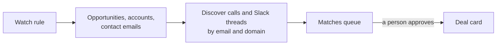

# Setting it up

**Connect your tools once, say which renewals to watch, and decide what counts as risk.**

Everything RevOps and GTM engineers set lives in one file, `gtm.yaml`. It is kept in Git, previewed
against the book, and activated by exact revision. It holds no credential.

```yaml
sources:
  crm:   {kind: salesforce}
  chat:  {kind: slack, channels: ["#deal-*", "#ext-*", "#renewals", "#deal-desk"]}
  calls: {kind: transcripts, folder: calls/}
watch:
  renewals_closing_within_days: 90
rules:
  customer_silence_days: 14
sellers: [Morgan Reed, Avery Linden]
timezone: America/Chicago
```

## How a deal gets its evidence



1. **The watch rule pulls** every open renewal opportunity that closes inside the window, with its account and contact emails.
2. **The connector discovers** matching calls and Slack messages by those emails and domains. In Slack it looks in dedicated channels, such as `#deal-thornfield`, and in threads of shared channels that mention the account's name or domain.
3. **Each match waits in the queue** until a person approves or rejects it. A rejected match adds nothing to any card.

A deal can also be registered by hand, with the IDs it binds. See [the API](api.md).

## Two ways data enters

| Way | What it covers |
| --- | --- |
| Scheduled background pulls | The CRM, Slack channels and threads, Gong and Zoom |
| Push API or custom SQL | Internal email, SMS, or tables in your own database |

A scheduled pull runs under a lease, so a stuck read blocks nothing else. Temporary failures are
retried. A bad credential stops the pull, and Setup shows why.

## Field mapping

Map the renewal date, recurring revenue and stage to the fields your org really uses. Setup checks
each mapping and refuses an ambiguous or mistyped one.

> **Opportunity amount never stands in for recurring revenue.** If no field is mapped, the card
> says the value is missing.

## Rules

Pick the rules and set their thresholds. Preview a change against the book before it applies: who
turns red, and what becomes unknown. Every result cites its records, its receipts and the rule
version that produced it.

## Under the hood

- **Whole-sentence splitter.** A quotation is one whole sentence.
- **HTML and link neutralizer.** Mentions, links and control characters become inert words before anything shows them.
- **Speaker and role matching.** Sellers come from your list, buyers from the account's contacts. Anyone else is unknown.
- **Versioned PostgreSQL store with audit receipts.** A read gets its receipt before it runs.
- **Risk and diff rules.** Silence, slippage and conflicts, computed by the connector.

## The Ops area

| Screen | What it answers |
| --- | --- |
| Coverage | Which deals have a current card, which do not, and why |
| Setup | Each source's state and last read, and the active file beside a draft |
| Activity | What ran, with its receipt, and whether it is safe to retry |

## Auto-stop and archive

On Closed Won or Closed Lost, polling halts and the final card is sealed. The deal leaves the
active list. Its cards, receipts and history stay readable.
