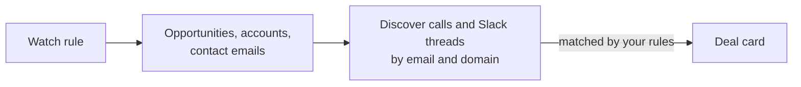

# Setting it up

**Connect your tools once, say which renewals to watch, and decide what counts as risk.**

Everything RevOps and GTM engineers set lives in one file, `gtm.yaml`. It is kept in Git, previewed
against the book, and activated by exact revision. It holds no credential.

```yaml
sources:
  crm:   {kind: salesforce}
  chat:  {kind: slack, channels: ["#deal-*", "#ext-*", "#renewals", "#deal-desk"]}
  calls: {kind: transcripts, folder: calls/}
  gong:  {kind: gong}
  inbox: {kind: push}                       # internal email, SMS, webhook push
  app:   {kind: sql, view: renewal_contacts}  # a read-only view in your own database
watch:
  renewals_closing_within_days: 90
rules:
  customer_silence_days: 14
sellers: [Morgan Reed, Avery Linden]
timezone: America/Chicago
```

## How a deal gets its evidence



1. **The watch rule pulls** every open renewal opportunity that closes inside the window, with its account and contact emails.
2. **The connector discovers** matching calls and Slack messages by those emails and domains. In Slack it looks in a dedicated internal or Slack Connect channel, such as `#deal-thornfield` or `#ext-thornfield`, and in threads of shared channels, such as `#renewals` or `#deal-desk`, that mention the account's name or domain. No thread is hard-coded.
3. **Each match joins its deal.** Nobody clicks.

Each call and thread belongs to one deal at most. Matching never puts evidence on a card it may not
belong to: what fits more than one deal waits for a person and reaches no card until one decides.

| The match fits | What happens | Why |
| --- | --- | --- |
| One deal | It joins that deal's card | Nobody clicks |
| Two deals of the same account, such as last year's renewal and this one | It waits in the matches queue and goes on neither card | Last year's words must not be read as this year's |
| Deals of two different accounts | It waits in the matches queue and goes on neither card, and both say so under what was not read | One customer's words must never reach another customer's card |

### What is built today

Discovery by email, domain and channel is not built. Today a call is imported for one account
(`debug calls import --account`) and a thread is mapped to one account (`debug slack map --account`),
and the connector matches each to a deal of that account:

- **The item's time decides.** A call's time is its `--called-at`, and a thread's is the time of its
  parent message. The deals of an account follow each other, and each holds the times from its own
  registration to the next deal's registration: the account's first deal also holds every earlier
  time, and its last-registered deal every later one. A call or thread joins the deal that holds its
  time, so a call made after a deal closed and before the next deal was registered belongs to the closed
  deal.
- **A call with no time** fits every deal of its account. While the account has had one deal, that
  deal takes it. Once it has had two, the call waits for a person.
- **When it is decided:** as a deal is registered, as a call is imported or a thread mapped while the
  account has an open deal, and before `brief` reads the account. Each item is decided once, and a
  person may decide it again.
- **What a deal's card reads:** the account's current call and thread only when they are matched to
  that deal. Otherwise the card says `Calls: not read. The account's transcript is not matched to this
  card.` or `Slack: not read. The account's thread is not matched to this card.` Every other card,
  made while the account has no open deal or through MCP, reads them unless they wait for a person or
  were rejected, and says the same when they do; an MCP read of them is refused as `calls_not_matched` or
  `slack_not_matched`.
- **A stale match** is one whose call or thread is no longer the account's current import or mapping.
  It leaves the queue, since no card can read it, and the full lists mark it `stale`.
- **Every decision has a receipt.** A `decide_match` receipt names the item, the decision and the deal,
  and the person who decided, or none for the connector. The decision and the receipt's finish commit
  together.
- **The card says what it read.** A deal's card names the match of each call and thread it read, and
  the database refuses a card that names a match it did not read for its deal. A card whose reads were
  made for another deal than the one open when it was published is not published.

Demo call notes and demo Slack messages belong to their account in the demo book and need no match.

## The matches queue

The queue holds every match that fits more than one deal. It is always on: such a match reaches no
card until a person decides it, through `GET /v1/matches` and `POST /v1/matches/{id}` ([the
API](api.md#matches)) or `deal matches` and `deal decide` ([the CLI](cli.md#deal)). A person puts it on
one deal of its account, or keeps it off every card.

The design adds a setting for a team that wants a person to confirm more. It is not built: there is no
`gtm.yaml` yet.

| `approval` in `gtm.yaml` | What waits for a person |
| --- | --- |
| `ambiguous`, the default | Only a match that fits more than one deal |
| `all` | Every match, before it reaches a card |

The setting can also be given per source, for example `all` for pushed records and `ambiguous` for the
CRM. The engineer turns it on in two steps: set it in `gtm.yaml`, then sign in and confirm the change
when the draft is previewed. The web app only reads this setting and has no switch of its own.

A deal can also be registered by hand, with the IDs it binds. See [the API](api.md).

## Two ways data enters

| Way | What it covers |
| --- | --- |
| Scheduled background pulls | The CRM, Slack channels and threads, Gong and Zoom |
| Push API or custom SQL | Internal email, SMS, or tables in your own database |

A scheduled pull runs under a lease, so a stuck read blocks nothing else. Temporary failures are
retried. A bad credential stops the pull, and Setup shows why.

## Field mapping

Map the renewal date, recurring revenue and stage to the fields your org really uses. Setup checks
each mapping and refuses an ambiguous or mistyped one.

> **Opportunity amount never stands in for recurring revenue.** If no field is mapped, the card
> says the value is missing.

## Rules

Pick the rules and set their thresholds. Preview a change against the book before it applies: who
turns red, and what becomes unknown. Every result cites its records, its receipts and the rule
version that produced it.

## Deterministic parsing and guardrails

Under the hood:

- **Whole-sentence splitter.** A quotation is one whole sentence.
- **HTML and link neutralizer.** Mentions, links and control characters become inert words before anything shows them.
- **Speaker and role matching.** A speaker is matched to a person by the strongest identifier the source carries: a Slack profile, the call's attendee list, an alias, then the name. Sellers are your Salesforce users and your list, buyers the account's contacts, and an email's domain shows a side for anyone else. Two candidates, or none, leave the role unknown.
- **Versioned PostgreSQL store with audit receipts.** A read gets its receipt before it runs.
- **Risk and diff rules.** Silence, slippage and conflicts, computed by the connector.

## The Ops area

| Screen | What it answers |
| --- | --- |
| Coverage | Which deals have a current card, which do not, and why. It also counts, by rule, the matches waiting because they fit more than one deal. |
| Setup | Each source's state and last read, and the active file beside a draft |
| Activity | What ran, with its receipt, and whether it is safe to retry |

Any line on any card opens a receipt drawer in Ops: the read that returned it, and its seal. Diffs
between two cards of a deal open the same way.

## Access

People sign in through your company's identity provider. The connector stores no password for
them. A grant names the deals a person reads, and whether they see Ops. A script or an assistant
gets a token limited to selected deals and scopes, and the token expires.

## Auto-stop and archive

On Closed Won or Closed Lost, polling halts and the final card is sealed. The deal leaves the
active list. Its cards, receipts and history stay readable.

Pause a deal to stop its scheduled reads and alerts without closing it, and resume it later.
